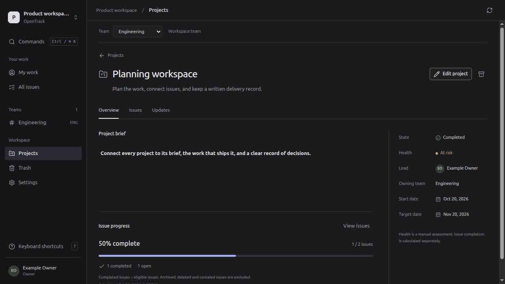

<p align="center">
  
</p>

<h1 align="center">OpenTrack</h1>

<p align="center">
  Self-hosted issues, projects, rich documents, and team collaboration.<br>
  A shared workspace for the browser and Linux desktop.
</p>

<p align="center">
  <a href="https://github.com/users/MimoAlexer/projects/3">Project board</a> ·
  <a href="https://github.com/MimoAlexer/OpenTrack/milestones">Milestones</a> ·
  <a href="https://github.com/MimoAlexer/OpenTrack/issues">Issues</a> ·
  <a href="docs/README.md">Documentation</a> ·
  <a href="docs/evidence/2026-10-22-started-batch.md">Latest work summary</a>
</p>

<p align="center">
  <a href="https://github.com/MimoAlexer/OpenTrack/actions/workflows/ci.yml"></a>
</p>



*Actual application during saved Projects verification. [Executed workflows and checks](docs/evidence/2026-10-20-projects.md).*

Keep issues, projects, discussion, files, and workflows together on your own server. The core runs without an AI account or a paid cloud service. Browser and desktop use the same accounts, permissions, and PostgreSQL data.

**Development checkpoint: schema 24, 22 October 2026.** Project milestones and team cycles now connect to the shared client, with reviewed close/carry-forward reports and accessible chart tables. The [started-batch record](docs/evidence/2026-10-22-started-batch.md) links implementation and verification; the full product is unfinished. The [requirements ledger](docs/REQUIREMENTS_STATUS.md) separates implemented behavior from remaining acceptance work.

## What works today

- **Issues with context.** Statuses, priorities, labels, eligible assignees, subissues, related/blocking/duplicate links, team moves and old-key aliases. Archive issues, or delete with a reviewed 30-day restore path.
- **Projects.** Team-owned projects with a rich brief, lead, dates, state and manual health. Link existing issues, read current progress, publish authored update snapshots, and archive or restore projects. Conflicting edits require review. [Projects guide](docs/PROJECTS.md).
- **Milestones and cycles.** Order project outcomes and assign linked issues; empty scope has no invented percentage. Plan team cycles with explicit local dates and timezone, immutable scope history, reviewed closure and selective carry-forward with conflict recovery. [Milestones](docs/MILESTONES.md) · [Cycles](docs/CYCLES.md).
- **Writing and discussion.** Structured descriptions, checklists and code; autosave with explicit conflict review; reviewed JSON/Markdown draft transfer, comments, attributable activity facts, attachments and current-access mentions/references. Personal subscriptions support automatic following or an explicit opt-out.
- **Reusable team workflows.** Versioned issue templates, opt-in team/date title patterns, preview and merge/replace choices, custom statuses and defaults, and durable status-replacement jobs.
- **Controlled access.** Private teams, invitations, account-session management, operator recovery and scoped authorization. A separate worker handles bounded background work and assignment cleanup.
- **Browser and desktop.** Compact properties, command palette, persistent character-shortcut preferences, guarded navigation sequences and light/dark themes. The Linux client embeds the same UI and uses browser sign-in plus the OS credential vault.

Subscriptions and mention intents are stored, but **inbox and email delivery are not implemented**. The desktop is an online client, not an offline workspace replica. Windows, macOS and signed updates remain pending.

## What comes next

The remaining roadmap includes native interaction and attachment/recovery qualification, boards, timelines and reporting parity; saved views, broader search, realtime and the inbox follow. Project briefs currently share the project metadata version; independent brief history, mentions, issue references and attachments remain unfinished. New backlog work is not assigned after the current batch without a new request.

The broader roadmap includes **initiatives, roadmap scenarios and capacity, retrospectives, decisions, feedback, releases, incidents and reports**, alongside integrations and optional AI/isolated agents. These are planned capabilities, not current screens.

[Browse the project board](https://github.com/users/MimoAlexer/projects/3) · [GitHub project guide](docs/GITHUB_PROJECT.md) · [Read the roadmap](docs/ROADMAP.md) · [See the concrete TODO list](docs/PROJECT_HANDOFF_2026-10-18.md#next-concrete-work)

## Run locally

Install [Docker Desktop](https://docs.docker.com/desktop/) on Windows/macOS, or [Docker Engine with the Compose plugin](https://docs.docker.com/compose/install/) on Linux. Use Linux containers, Engine 28 or newer and Compose 2.24.4 or newer. From this repository's root:

```sh
docker compose up --build -d --wait
docker compose ps
docker compose run --rm --no-deps -T credentials setup-token --app-secrets /run/secrets
```

Once `app` is healthy, open **http://localhost:8080** and paste the displayed token into first-owner setup. Docker builds the application, initializes PostgreSQL, applies migrations and starts the restricted worker; **Rust, Node, Python and PostgreSQL are not host prerequisites**. Database state, attachments and generated credentials live in named Docker volumes. `docker compose down` stops the installation while preserving those volumes.

See the [Docker guide](docs/DOCKER.md) for prerequisites, a different port, HTTPS, storage, troubleshooting and the exact platform qualification status. The default port is bound to this computer's loopback interface.

### Develop without Docker

The Linux source-development path requires the pinned Rust toolchain (`rust-toolchain.toml`), Node 22, Python 3 and compatible system libraries. Its launcher prepares a separate PostgreSQL 18 instance, builds the app, and starts the API and restricted worker.

```sh
scripts/dev.sh
```

Open **http://127.0.0.1:18970**. On a fresh source-development installation, use the owner-only token at `work/postgres/setup-token`. See [runtime setup](docs/RUNTIME_SETUP.md) for this development path's configuration and shutdown commands.

### Linux desktop

```sh
desktop/scripts/build-linux.sh
python3 desktop/scripts/install-user-linux.py
```

The build also produces a `.deb` under `desktop/target/release/bundle/deb/`. Launch **OpenTrack**, select your running server and sign in through the browser. Compatible runtime libraries and an OS credential service are required. [Desktop setup and current platform limits](desktop/README.md).

### Verify a change

```sh
scripts/check.sh                  # Rust, real PostgreSQL, contracts, frontend
desktop/scripts/check.sh          # Separate native checks
```

The 20 October Projects checkpoint passed **183 Rust tests, 495 frontend tests across 61 files, 47 native checks and 12 helper checks**, plus strict lint/type/contract/build gates. Hosted Docker qualification passed on AMD64 and ARM64, with **27 browser cases** across Chromium, Firefox and WebKit. [Qualification evidence](docs/evidence/2026-10-20-projects.md) includes saved workflows, schema upgrade and database restore. These results do not claim complete product, populated-blob recovery or native GUI qualification.

## Inside the repository

Rust owns business rules; PostgreSQL owns durable state. The React/TypeScript application uses generated API types, and Tauri provides the restricted native shell. API, worker, operator and migrator have separate database capabilities.

| Path | Purpose |
| --- | --- |
| [`crates/`](crates) | Domain models, SQL/migrations, use cases, Axum API, adapters and server/worker entry points |
| [`web/`](web) | Shared React/Vite UI and Tiptap editor |
| [`desktop/`](desktop) | Tauri shell, OS-vault authentication, native transfers and packaging |
| [`scripts/`](scripts), [`deploy/`](deploy) | Local runtime, verification, restricted provisioning and Compose configuration |
| [`docs/`](docs/README.md) | Feature contracts, ADRs, design, roadmap and executed evidence |

[Architecture](docs/ARCHITECTURE.md) · [API contract](docs/API_DESIGN.md) · [Security model](docs/SECURITY_ARCHITECTURE.md) · [Configuration](docs/configuration/IMPLEMENTED_SETTINGS.md)

## Working on OpenTrack

Use [Issues](https://github.com/MimoAlexer/OpenTrack/issues) for concrete bugs and deliverables, and [Milestones](https://github.com/MimoAlexer/OpenTrack/milestones) for the delivery sequence. Read [contributing](CONTRIBUTING.md), [AGENTS.md](AGENTS.md) and the [current handoff](HANDOFF.md) before changing a contract. Follow the [security policy](SECURITY.md) for sensitive reports. Applied migrations are immutable; credentials, local databases and raw private run logs stay out of Git.

## License status

Licensing has **not been ratified**. AGPL-3.0-or-later is proposed in [ADR-015](docs/adr/015_LICENSE.md); this repository does not currently grant that proposed license. Release, signing and distribution decisions remain explicit open work.
