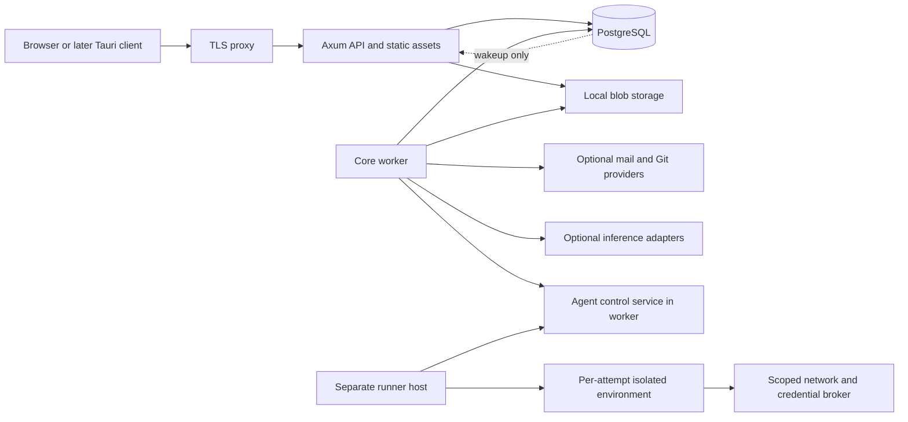

# System architecture

Status: target architecture for authorized implementation; current verification is recorded in [REQUIREMENTS_STATUS](REQUIREMENTS_STATUS.md). See [ADRs](adr/README.md), [database](DATABASE_DESIGN.md), [API](API_DESIGN.md), [security](SECURITY_ARCHITECTURE.md), and [realtime](REALTIME_ARCHITECTURE.md).

## Baseline and deployable units

The core is one Rust modular monolith with an API mode and a worker mode built from the same workspace. Start with one API process and one worker process, PostgreSQL 18, a local blob volume, and a TLS reverse proxy. The API serves built SPA assets. The Node toolchain is a build dependency, not a required core production server. No Redis, Kafka, external search daemon, cloud identity, email service, or AI provider is required for the core.

Core workers perform trusted housekeeping and integration calls. They never execute repository code. Agent runners have a separate identity, failure domain, resource budget, and optional installation. A production runner for untrusted repositories requires a disposable VM or equivalent stronger isolation; rootless containers alone are an explicitly restricted trusted-owner profile.

## Invariants

| ID | Rule | Owning contract |
| --- | --- | --- |
| I01 | Workspace is the content tenant; organization administration confers no implicit content access | Database, security |
| I02 | Every issue has one team; MVP projects have one owning team; issue/project/team workspace and team must agree | Database |
| I03 | Read/write authority is checked server-side at execution time, including search, streams and workers | Security |
| I04 | Mutation, version increment, activity, audit where required, and durable event append commit atomically | Database, realtime |
| I05 | Events and jobs can be delivered more than once; consumers are idempotent; external effects may require reconciliation | API, jobs |
| I06 | A durable event cursor follows commit-visible workspace order, not a sequence allocated before commit | Realtime |
| I07 | Conflicting writes never silently overwrite; If-Match is mandatory for mutable entity updates | API |
| I08 | Durable changes never depend on external provider success inside their transaction | Integrations |
| I09 | Runner grants can shrink, expire and be revoked; repository instructions cannot expand them | Agent security |
| I10 | Complete core operation, backup and export do not depend on AI, cloud, Redis or internet availability | Deployment |
| I11 | Permission revocation prevents new authorized operations and purges affected UI caches; audit remains restricted | Security |
| I12 | Documented numbers are budgets until a named benchmark or test records a measurement | Performance |

## Cargo boundaries

The root workspace implements six crates: domain, store, app, adapters, API and server. The native shell is a separate workspace under `desktop/`. `scripts/check-workspace-boundaries.py` checks both Cargo metadata inventories, including optional, renamed, build and platform-specific dependencies. Unknown product packages or local edges require an explicit policy review. `scripts/check.sh` runs the checker and its mutation regressions before the existing Rust format, Clippy and runtime checks.

| Crate | Responsibilities | Allowed inward dependencies |
| --- | --- | --- |
| opentrack-domain | IDs, value objects, validation, permission predicates, state transitions; no I/O | std plus narrowly justified Serde/time/UUID types |
| opentrack-app | Use cases, transaction orchestration, feature modules, bounded ports for external systems | domain, store; SQLx transaction types permitted deliberately |
| opentrack-store | SQLx repositories, query projections, migrations, leases, blob metadata persistence | domain; no app orchestration |
| opentrack-adapters | SMTP, GitHub, inference protocols, blob implementations, credential-envelope implementation | domain and app ports; no API transport |
| opentrack-api | Axum extraction, session middleware, REST/SSE, serialization, static asset serving | app, domain, blob adapter; store/SQLx only in integration tests, no direct feature-table SQL |
| worker modules in app/server | Durable job execution, projections, schedules, outbox deliveries, agent control plane | app use cases/store; server composes adapters, no separate worker crate |
| opentrack-server | Composition root, validated config, shared observability, process lifecycle; API/worker subcommands | all core crates |
| opentrack-desktop | Native transport, vault, transfer and lifecycle shell; server remains authorization authority | no backend crates or database drivers |
| opentrack-runner (not implemented) | Later independent binary: enrollment, environment supervision, log/artifact transfer | domain protocol types only; no database credentials |

Concrete SQLx-backed repositories are acceptable inside app use cases. Do not invent a generic repository/transaction framework or async trait for every table. A transaction is opened by a use case and passed explicitly to store functions; external ports exist where an alternate provider or a fake is useful. Store never calls app. Domain never imports Tokio, Axum, SQLx, or a provider SDK; its external library allowlist contains only current value/validation/serialization/schema dependencies. API transport dependencies stay out of app/store/adapters/native; database drivers stay in app/store/composition, with API integration-test access only. All owned packages use Rust 2024. Expose small feature modules within app: identity, tenancy, tracking, planning, collaboration, automation, integrations, AI, and agents. Split more crates only when compile-time or ownership evidence warrants it.

The API composition root receives a state object containing an application service, PgPool handles, shutdown token, bounded broadcaster and immutable validated settings. Do not place mutable domain state in global singletons. The frontend organizes feature modules and a shared design system; generated wire types are distinct from local UI state.

## Request and transaction flow

Authenticate the opaque session or scoped token; parse and validate limits; enter a workspace-scoped SQL transaction; set RLS context; acquire the user authorization guard in shared mode, then the workspace authorization guard in shared mode; load current membership/permission facts; claim/check the scoped idempotency record; lock the workspace planning scope if mutating a cross-project graph; lock team graph/counter/ordering rows in team UUID order, then affected entity rows in entity UUID order; apply invariants; append audit and activity; lock the workspace stream head last; assign durable event sequence and append the event; commit; return the entity and version. Failures roll back the entire write. Never send an SSE notification from an uncommitted write.

Changes to workspace memberships, roles or privacy acquire the workspace guard exclusively. Targeted member and team-grant changes first acquire actor and target account guards in ascending UUID order: actor `FOR SHARE`, target `FOR NO KEY UPDATE`, deduplicated to one exclusive guard for self-changes. Both precede the workspace guard; no account lock is added after a workspace lock. Changes that can expand access use this order even when the eventual update is unchanged or reduces access. Account session revocation and login rotation acquire the user row directly with `FOR NO KEY UPDATE`; ordinary authenticated commands use `FOR SHARE` and recheck session validity while holding it. Never upgrade a shared guard to an exclusive guard. `NO KEY UPDATE` permits unrelated foreign-key key-share checks, avoiding cross-user membership deadlocks. Therefore a competing command either commits before revocation or rechecks after it; it cannot check old authority then commit later unnoticed. The lock order is sorted user authorization guards → sorted organization guards when needed → sorted workspace authorization guards → idempotency record → workspace planning scope when needed → sorted team scope rows → sorted entity rows → stream head. Commands that do not need a stage skip it; no reverse acquisition. Global account disable/enable uses one exclusive target account guard, sorted organization guards, then all affected workspace guards. It rechecks enabled-owner invariants without taking later account locks; credential invalidation, mandatory audit and epochs commit atomically. The guard is not held over network calls. Read requests run an authorized snapshot; data already delivered cannot be recalled. Streaming and delayed delivery reauthorize before sending. See the stronger precision in SECURITY_ARCHITECTURE.md.

## Async execution and resource ownership

One Tokio runtime per process. Supervise long-lived services using a JoinSet/task tracker and CancellationToken; each task has an owner, purpose, bounded input queue and shutdown policy. Detached spawn is forbidden. Request-local fan-out has a semaphore and a timeout. Password hashing, compression, image decoding and large parsing use bounded blocking pools; a blocking task is not assumed cancellable after spawn_blocking starts. Bound payloads before allocating them.

Default API pool 20 connections, worker pool 5, one dedicated LISTEN connection per API process, plus operator/migration reserve. A request obtains a database connection only when needed. Do not hold a transaction while streaming, waiting for approval, contacting a provider or reading a whole upload. Bulk operations batch by 100 rows; reports use separate low-priority budgets. Timeouts are listed in CONFIGURATION_POLICY.md.

Shutdown: stop readiness and new requests/claims; cancel stream producers; drain ordinary HTTP requests for 30 seconds; release or let leases expire; signal adapters; close pool and flush bounded telemetry. A hard deadline ends the process. Do not kill remote coding environments merely because an API process restarts; lease fencing and runner reconciliation own that lifecycle.

## Errors and integration boundaries

Domain errors are typed and stable: invalid input, forbidden, absent, conflict, precondition required, capacity limit, dependency unavailable. API maps these to problem+json; logs contain an error chain and request ID, never bearer tokens or document bodies. A panic is a bug: isolate failing worker attempt, record failure, alert, and restart a failed critical service. No blanket catch-and-continue for corrupted state.

External calls use bounded request/response sizes and timeouts, capped exponential backoff with jitter only for retryable operations, and circuit-breaker metrics rather than perpetual background retry. User intent and its external operation record commit before dispatch. Outbound requests never inherit browser headers wholesale. A timeout after sending an external write becomes reconciliation_required unless its idempotency contract proves a safe retry.

## Events, jobs and projections

workspace_events is the replay log and durable source for asynchronous projections, retained for a seven-day browser replay window and longer when required consumers have not durably captured their work. Purging obeys the consumer watermark contract in REALTIME_ARCHITECTURE.md. Activity is a product history with a longer lifecycle; audit is a restricted security history. They are deliberately separate. Each projection uses (consumer,event_id) receipts and checkpoint state, so one consumer cannot consume another's work. Notification/email/webhook delivery has its own retries and retention. A PostgreSQL jobs table uses short SKIP LOCKED claims, renewable leases, attempt limits and fencing tokens. See the database and agent lifecycle documents.

## API evolution and testing seams

Public /api/v1 is the same business surface used by the UI, with stricter token scopes where relevant. /internal/v1 runner control has a separate authenticated listener and audience. No privileged hidden browser API. Additive fields are allowed within v1; incompatible semantics need v2 or an opt-in capability. OpenAPI JSON and generated TypeScript types will be checked for drift during implementation.

Current user-session ingress accepts only `web` cookies or `desktop` bearer credentials and queries the stored audience explicitly. Machine/control ingress remains unimplemented. The database and user-session type reject `internal`; the real PostgreSQL audience regression also admits an internal row in an isolated fixture to prove neither user authentication path accepts or refreshes it, independently of that database constraint (F31-A4).

Unit tests cover pure invariants, real PostgreSQL tests cover transaction and RLS behavior, adapter fixtures cover provider boundaries, and two-client browser tests cover convergence. Document compatibility has been researched; no crate combination or application behavior has been executed in Phase 0.

## Approved expansion boundaries

The complete-product authorization adds F37–F47 within the existing modular monolith. Planning owns initiatives/outcomes/scenarios/capacity; collaboration owns routines/retros/decisions/notes; tracking owns feedback/releases/incidents and their ordinary issue links; reporting owns bounded derived views. These are modules, not additional mandatory services. Shared field/template/transfer machinery must invoke each domain's validation and permission rules.

The expanded canonical lock order is sorted user authorization guards → sorted organization guards when needed → sorted workspace authorization guards → idempotency → workspace planning scope when a cross-project graph is mutated → sorted team scopes → sorted entity rows → stream head. All existing paths may omit unneeded stages but may not reverse them. Scenario apply is bounded to 100 projects and atomic; larger proposals are split explicitly before apply. Raw retro access is team access intersected with session participation. Historical snapshots retain source references and reauthorize at read time; copied data cannot serve as an access bypass. [ADR-016](adr/016_PRODUCT_EXPANSION.md) records these decisions.

Expansion work preserves I01–I12 and the same Rust ownership, PostgreSQL durability, event ordering and external-effect boundaries. Required implementation evidence is enumerated in [REQUIREMENTS_STATUS](REQUIREMENTS_STATUS.md). The initial Phase 0 architecture review remains historical evidence of document checks, not a current runtime review.

## First executable worker

The first worker is the `opentrack-server worker` mode, with its orchestration in `opentrack-app::worker` and process supervision in `opentrack-server::worker`; a separate crate is not needed for this size. It uses its own restricted credential and no HTTP listener. `worker --once` attempts at most one bounded batch. The foreground mode discovers eligible workspace IDs with a bounded cursor and polls while idle; shutdown stops claims and drains the current batch for at most 30 seconds.

Foreground scheduling permits at most four consecutive claimed batches in a discovered workspace before advancing that cursor. Each batch uses a fresh ordinary claim and effect transaction; the other four maintenance stages run between batches. An empty probe, error or lost lease ends the local quantum, and no-claim probes still consume the existing four-call discovery budget. This retains per-workspace FIFO, current-authority checks, fencing and the default idle interval without repeatedly traversing idle workspaces between every queued batch.

The initial job is team workflow status replacement. Its committed effects follow account guard → workspace guard → job/lease and attempt → team → sorted status/issue rows → activity/audit/progress → stream head. The claim transaction is short and separate. Effect transactions recheck current authority and lease fencing, and every required effect must succeed before commit. The worker receives only the issue identity/status/version columns it needs, without issue text or authentication records. Separate credentials keep API, migration, operator recovery and worker capabilities distinct. This implementation does not yet provide consumer receipts/checkpoints, retention, notifications or external delivery jobs.
