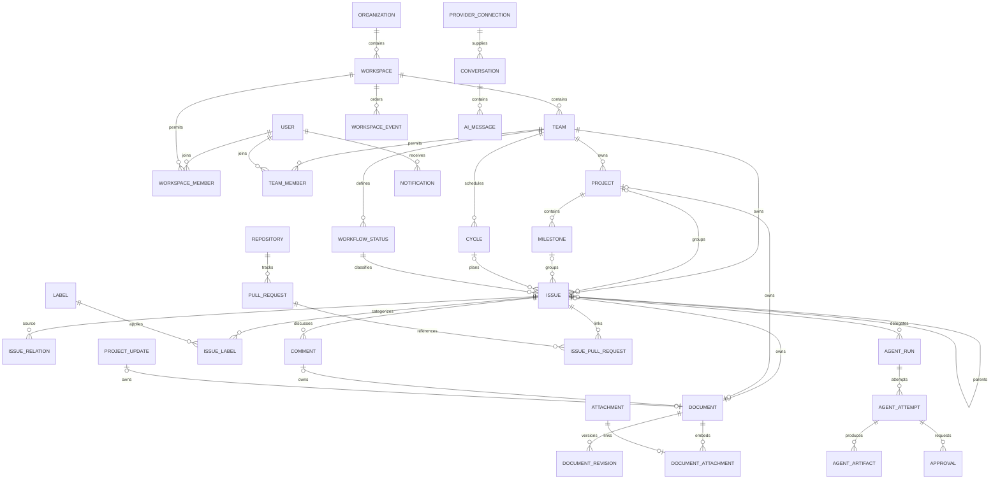

# Database and persistence design

This is a logical and constraint specification, not executable DDL. PostgreSQL 18 is the baseline. [Architecture invariants](ARCHITECTURE.md), [API](API_DESIGN.md), [realtime ordering](REALTIME_ARCHITECTURE.md), [retention/restore](DEPLOYMENT_ARCHITECTURE.md).

## Conventions and tenant boundary

Primary keys are application-generated UUIDv7 except opaque security tokens. UUID order is never used as commit order. All timestamps are timestamptz in UTC; business calendar fields are date plus an IANA timezone on the owning team. User-visible issue keys are a team prefix and monotonically increasing integer, e.g. ENG-142. Prefix history resolves old links; an issue UUID never changes on a same-workspace team move. Numbers are never reused.

Workspace-owned tables have non-null workspace_id, UUID id, created_at, updated_at and version bigint >= 1 where mutable. Each has UNIQUE(workspace_id,id), and references to tenant objects use composite foreign keys including workspace_id. A globally unique UUID alone is insufficient evidence of tenant consistency. Identity tables are globally scoped explicitly; memberships connect them to content tenants.

Organization is an administrative container. MVP creates a default organization and permits multiple workspaces; organization membership confers administrative functions only. Users need a workspace membership for content. A workspace owner still requires membership in a private team to read its content. MVP projects belong to one team; project visibility inherits that team, and linked issues must belong to it. Multi-team projects and guest ACLs require M14 and a revised access model before schema expansion.

## Entity relationships

This diagram omits operational/link tables for readability; the catalog below is authoritative. Every scoped relationship in the diagram is tenant-qualified.

## Identity, tenancy and configuration catalog

Columns below are in addition to the applicable common fields. PK=id unless specified. FK means a scoped FK except references to global users/organizations.

| Table | Required data and constraints | Main indexes / deletion |
| --- | --- | --- |
| users | normalized_email, display_name, password_hash nullable, disabled_at; email unique under documented case-folding policy | normalized_email unique; anonymize rather than cascade authored history |
| user_identities | user_id, issuer, subject; unique(issuer,subject); never link solely by matching email | user_id; unlink requires another login/recovery path |
| sessions | user_id, token_hash unique, csrf_hash, idle_expires_at, absolute_expires_at, revoked_at, auth_time | token_hash, user_id, expiry; purge expired rows |
| recovery_tokens | user_id, purpose, hash unique, expires_at, used_at; single-use atomic consume | expiry; erase used/expired token hashes |
| organizations | name, slug unique, lifecycle state | retain until child workspaces gone |
| organization_members | organization_id,user_id,admin_role; unique pair | user_id; preserve at least one owner |
| workspaces | organization_id,name,slug unique per organization,timezone,deleted_at | organization_id; tombstone before scheduled purge |
| workspace_members | workspace_id,user_id,role owner/admin/member/viewer,state; unique pair | user_id,state; deactivate membership, preserve historical attribution |
| invitations | workspace_id,email_hash,role,token_hash,expires_at,inviter_id,accepted_at | unique active invite per workspace/email; short-lived token; optional team grants |
| invitation_teams | workspace_id,invitation_id,team_id; unique triple | both parents; revalidate authority when accepted |
| workspace_auth_guards | workspace_id PK, epoch bigint; locked for authorization changes | one row/workspace; never reused after purge |
| teams | workspace_id,name,prefix,visibility workspace/private,timezone,next_issue_number,archived_at | unique(workspace_id,prefix); prefixes reserved forever within workspace |
| team_prefixes | workspace_id,prefix,team_id,valid_from,valid_to | unique(workspace_id,prefix); resolve historical keys |
| team_members | workspace_id,team_id,user_id,team_role contributor/maintainer | unique(workspace_id,team_id,user_id); user must be active workspace member |
| workspace_settings | workspace_id PK,settings_version,typed JSONB for user-managed preferences | validated allowlist only; not infrastructure secrets |
| user_preferences | user_id,workspace_id,theme,density,timezone,shortcut_mode,notification prefs | unique(workspace_id,user_id); validate all enum fields |
| api_tokens | workspace_id,user_id,token_hash,scopes,expires_at,last_used_at,revoked_at | hash unique; scopes can only narrow current membership |

Invitation expiry uses current database clock time, including a final conditional single-row consume after grant validation; transaction-start time cannot extend a token across waits. Replacing an expired pending invitation increments the old version, records `invitation.expired_replaced` in restricted audit and creates the replacement in one transaction. Retirement alone emits no event and advances no authorization epoch because the expired credential grants no usable access. The old invitation may contain private grants inaccessible to the issuer, so its ID remains absent from replacement responses and new workspace events. Required identity audit/event writes and single-session audit writes verify insertion counts, rolling back when a trigger silently skips a row.

Cross-table active membership cannot be expressed by a simple FK. Use explicit application validation under the authorization guard, and a database constraint trigger for team-membership existence and last-owner protection. Targeted access-expansion commands take sorted actor/target account guards before the workspace guard. Session revocation, the grant update, epoch, workspace audit and event are one transaction. Existing append-only account events use `user_id` as the affected account, not necessarily the actor: a shared `correlation_id` equals the linked workspace audit ID and event `mutation_id`, whose audit records the true actor and target. The application temporarily sets the account audit RLS context to the locked target and restores the actor before workspace audit; it adds no broader read policy. Membership deactivation is one transaction that revokes sessions/tokens as appropriate, invalidates assignments where needed, increments epoch and records audit/events. Global disable/enable acquires the target account, sorted organization and sorted workspace guards. The current identity effects (disabled state, credential and outgoing invitation invalidation, epochs and audit) commit atomically; future assignment and projection cleanup uses individually fenced jobs. Global authentication rejects the disabled user immediately.

Migration 0007 counts only enabled users when preserving active workspace owners and organization owners; archived workspaces retain this invariant. Deferred membership checks set and restore their own workspace scope. Migration-owner-only metadata SELECT policies on workspaces and organization memberships allow the fixed-path definer checks to operate under FORCE RLS, without changing runtime policies or private-content visibility. The runtime role cannot directly change `users.disabled_at` or insert operator-attributed audit/events. An operator action has `actor_kind=local_operator` and no fabricated `actor_id`; its database `session_user` is stored only in restricted audit. Distinct workspace audit IDs share the command’s explicit `correlation_id`; stream `mutation_id` and account audit use the same correlation. Existing account audit correlations remain their row IDs. Operator stream payloads are generic `access.changed` events scoped to the workspace, with no reason, operator identity or private-team references.

## Tracking and collaboration catalog

| Table | Required data and constraints | Main indexes / deletion |
| --- | --- | --- |
| workflow_statuses | workspace_id,team_id,name,category triage/backlog/unstarted/started/completed/canceled,rank,is_default,retiring_at,replacement_status_id nullable,archived_at | unique live name per team; one active default per team; prohibit delete while referenced |
| projects | workspace_id,team_id,name,summary,narrative_schema_version,narrative_body,narrative_plain_text,lead_id nullable,state,start_date,target_date,health,version,archived_at | Implemented in 0022; (workspace_id,team_id,lower(name),id) directory index; date order check; archive/restore, no deletion |
| project_issues | workspace_id,team_id,project_id,issue_id,created_at | Implemented in 0022; PK(workspace_id,issue_id); team-qualified project and issue FKs; (workspace_id,project_id,issue_id) index |
| project_updates | workspace_id,team_id,project_id,author_id,body,state,health,completed,eligible,created_at | Implemented in 0022; immutable snapshot; (workspace_id,project_id,created_at DESC,id DESC) feed index; corrections remain future work |
| milestones | workspace_id,project_id,title,target_date,rank,state planned/completed,completed_at nullable | unique(workspace_id,project_id,id); project index |
| cycles | workspace_id,team_id,name,start_date,end_date_exclusive,state,closed_at | daterange exclusion for overlapping non-deleted cycles per team using btree_gist; end > start |
| cycle_snapshots | workspace_id,cycle_id,local_date,scope_count,completed_count,estimate_total,definition_version | unique(cycle_id,local_date); replayable; explicit late correction |
| issues | workspace_id,team_id,created_by_user_id,number,title,status_id,priority 0..4,assignee_user_id nullable,project_id nullable,milestone_id nullable,cycle_id nullable,parent_id nullable,estimate nullable,due_date,rank,archived_at,deleted_at | unique(workspace_id,team_id,number); indexes below |
| issue_relations | workspace_id,source_id,target_id,type blocks/related/duplicate | no self-link; unique(type,source,target); canonical UUID ordering for related |
| labels | workspace_id,team_id nullable,name,color_token,archived_at | unique live case-folded name per scope via NULLS NOT DISTINCT |
| issue_labels | workspace_id,issue_id,label_id | PK(workspace_id,issue_id,label_id); reverse(label_id,issue_id) |
| issue_subscriptions | workspace_id,issue_id,user_id,preference automatic/subscribed/unsubscribed,creator/assignment/mention source flags,version | unique(workspace_id,issue_id,user_id); explicit unsubscribe overrides repeated automatic subscription; automatic source history persists |
| subscription_events | workspace_id,id,user_id,issue_id,subscription_version,preference,created_at | private append-only preference history; unique(workspace_id,issue_id,user_id,subscription_version) |
| document_mentions | workspace_id,document_id,user_id | current unique reference set, derived transactionally from document JSON; scoped document FK |
| mention_intents | workspace_id,id,issue_id,document_id,document_version,origin_team_id,recipient_id,actor_id,created_at | private append-only source; unique(workspace_id,document_id,document_version,recipient_id); no name/body copies or FK to expiring replay/revision rows |
| discussion_sources | workspace_id,id,issue_id,comment_id,document_id,document_version,origin_team_id,actor_id,created_at | one private source per new comment for later subscriber fan-out; no recipient/body copies |
| documents | workspace_id,schema_version,body JSONB,plain_text,version,deleted_at; exactly one of issue_id/project_id/comment_id/project_update_id non-null | Unique per non-null owner FK; all owner references composite; no full JSONB GIN by default |
| document_revisions | workspace_id,document_id,revision,body,author_id,created_at | unique(document_id,revision); prune body history by policy |
| comments | workspace_id,issue_id,author_id,edited_at,deleted_at | (issue_id,created_at,id); soft deletion replaces visible body with tombstone |
| attachments | workspace_id,uploader_id,upload_team_id,storage_key,sha256,size_bytes,detected_mime,original_name,state pending/quarantined/ready/rejected/deleted,expires_at | storage_key unique; state/created_at; blob cleanup only after retention |
| document_attachments | workspace_id,document_id,attachment_id | composite PK plus unique(workspace_id,attachment_id); one containing document in MVP; no implicit public links |
| activity_entries | workspace_id,team_id,entity_kind,entity_id,actor_id,event_kind,before_summary,after_summary,created_at | (workspace_id,entity_kind,entity_id,created_at,id); summaries exclude secrets |
| saved_views | workspace_id,owner_id,team_id nullable,name,visibility personal/team/workspace,filter_schema_version,filter_ast JSONB,layout,sort,group_by | owner/team; membership does not expand result ACL |
| saved_searches | workspace_id,owner_id,name,text_query,filter_ast,schema_version | owner_id; private initially |
| issue_templates; issue_template_sources | Current team definition, typed defaults, document/schema, version/digest; immutable per-issue source team/template/version/digest | Normalized team/name uniqueness and 100-definition cap; source composite FKs; current references revalidated at use |
| notification_preferences | workspace_id,user_id,event_kind,channel,enabled,digest_minutes | unique(user,event_kind,channel) |
| notifications | workspace_id,user_id,event_id,entity_kind,entity_id,reason,read_at,archived_at,snoozed_until | unique(user_id,event_id,reason); inbox unread partial index |
| notification_deliveries | workspace_id,notification_id,channel,state,attempt,next_attempt_at,provider_reference | unique(notification_id,channel); state/next_attempt_at |

The catalog includes future fields as well as implemented relations. In migration 0022, project membership lives in `project_issues`, not `issues.project_id`. Composite FKs from that relation to both projects and issues include `(workspace_id,team_id)`, enforcing a single shared team. Migration 0023 adds `milestones` and `project_issues.milestone_id`; its FK includes `(workspace_id,team_id,project_id)` and milestone deletion sets only the nullable milestone ID to null. Project membership and issues survive. Server-owned positive integer milestone ranks have deferred project uniqueness, with complete reorders bounded to 500 entries and guarded by the project version. See [Milestones](MILESTONES.md) for state, counts and recovery. Status uses a team-qualified FK; cycles remain future schema and must retain team equality. A parent must be in the same team in MVP; it need not share project/cycle. Bound hierarchy depth to 8. Reparenting and issue-relation writes acquire a transaction-scoped team graph lock before traversing ancestors/blocking paths, so concurrent opposite edges cannot both pass cycle checks. Duplicate links target a canonical non-duplicate root, with no automatic copying of restricted content. A database trigger checks recursive integrity; the app supplies friendlier errors.

An assignee/lead is a global user reference plus checked active workspace/team visibility. Deactivation unassigns open issues in bounded batches with activity; it does not delete historical comments. Team transfer locks source and destination teams in UUID order, maps status explicitly, clears incompatible project/milestone/cycle/labels, allocates a new number and writes an issue_key_alias. The current transfer accepts only one active, childless, fully unlinked issue and requires a reviewed status, assignee and label set. A project-linked issue must be detached before moving; milestone/cycle handling awaits their implementation. Cross-workspace issue moves are unsupported; export/import creates distinct objects with explicit mapping.

| Auxiliary table | Contract |
| --- | --- |
| issue_key_aliases | workspace_id,team_prefix,number,issue_id; unique key; historical route redirect after authorization |
| favorites | workspace_id,user_id,issue_id/project_id/view_id/team_id exactly one non-null; reauthorize on render |

Document ownership is represented once: concrete nullable owner columns on documents, an exactly-one-owner CHECK and a unique partial index for each owner kind. Parent rows do not duplicate a document_id backlink. Resolve team access through the current owner, including author/moderator rules for comment bodies. This avoids stale team copies after issue moves and circular ownership bookkeeping. Parent/document creation is one transaction; required-body presence is validated by use case plus deferred constraint trigger where needed.

Migration 0016 implements issue and comment owners first; project and project-update ownership remain future schema extensions. Migration 0022 stores a project narrative directly on `projects` and a plain-text body on each immutable update. This bounded first increment shares project metadata versioning; it does not yet implement the independent document ownership/revision contract for projects. `issues.description` and `issues.body_version` are checked projections, not ownership links. Comments and revisions retain an immutable `origin_team_id` as an additional historical audience restriction. This never grants access independently of the current owner. The current issue description travels with an explicitly moved issue; old private discussion and revisions do not become public through that move.

Revisions are append-only and remain API-visible for 90 days. The restricted worker prunes at most 1,000 expired superseded revisions per call, preserving the current revision and recording an atomic count and cutoff in `document_retention_operations`. The serving role cannot access that maintenance log; the worker receives only the pruning capability, without document body table access. Comment deletion clears the canonical body and leaves a minimal tombstone; earlier revisions expire under the same policy. Initial body, revision and required audit commit with issue creation; edits include revision, audit, activity and event effects in one transaction.

Attachment reservation binds uploader and upload_team_id. Before an issue exists, a draft upload is readable only by its uploader and can be linked only to a newly created/current writable document in that team. Once linked, download authorization follows that document. Reusing in a different document requires an explicit copy operation and renewed authorization; metadata/blob storage keys are independent. Parent creation/linking is transactional after file readiness; no blob I/O occurs under the transaction.

Manual issue rank is numeric(38,18), initially spaced by 1024. Client sends before/after neighbor IDs, never a trusted rank. Server locks the team ordering scope, validates current same-group neighbors and calculates midpoint; tie order includes UUID. If precision is exhausted, rebalance at most 500 affected siblings in a bounded transaction; larger scopes use a visible maintenance job and reject moves until ready. A stale neighbor pair yields 409 and refreshed order. Keep the lock order below consistent across graph, ordering, transfer and counter allocation.

Migration0027's implementation slice adds `teams.ordering_version`, finite signed
`issues.rank` with no default, typed `issues.order_normalize` jobs,
`issue_order_normalizations`, group-keyed `issue_order_guards` and private
`issue_order_staging`. All new relations are workspace-scoped with FORCE RLS and
scoped foreign keys. The offline owner backfill preserves retained issue metadata,
versions, documents and relationships; it assigns spacing1024 within each
workspace/team/status by the previous created-at/ID order. Deferred issue triggers
are flushed before altering the populated table; they are not disabled.

Logical Issue.version and membership/rank changes advance the ordering generation,
including source/destination teams in sorted lock order. Body projections that do
not change Issue.version are exempt. Active markers block group membership/rank
changes; ordinary title/priority/assignee/label edits remain usable. Workflow
replacement and normalization exclude one another at source and destination.

The inline definer capability is API-only and bounded to a501-row probe/500-row
rewrite. The worker-only fixed-path capability stages original(rank,ID) by indexed
keyset in batches of at most100, then applies consecutive ordinals in batches of
at most100. The worker receives no general rank/generation/staging write grant.
Each effect uses the current execution actor, exact marker and live lease/fence;
permitted logical edits may advance team generation and do not invalidate a
normalization fence. Physical normalization changes no Issue.version, updated_at,
document or Issue history. Completion generation, marker removal, progress and
final fenced job state commit atomically. Blocked work retains its marker and
progress for explicit versioned manager takeover; original requester is retained.

This is an additive forward migration, not authorization to apply an unpublished
slice to retained application data. An earlier binary must use its matched database
snapshot; do not introduce a rank default or edit applied migration checksums as a
rollback substitute.

## Operational, integration and AI catalog

| Table | Required data / integrity |
| --- | --- |
| workspace_stream_heads | workspace_id PK,last_seq bigint; serializes commit-visible event assignment |
| workspace_events | workspace_id,seq PK pair,event_id UUID unique,event_type,schema_version,entity_kind,entity_id,entity_version,actor_id,mutation_id,causation_id,occurred_at,payload; minimal content, seven-day browser replay plus required-consumer watermark retention |
| consumer_receipts | consumer_name,workspace_id,event_id,state; unique triple; effect and receipt in same DB transaction |
| consumer_checkpoints | consumer_name,workspace_id,last_seq; never advance past an unapplied event; dead letters retain the checkpoint until retry or an audited durable reconciliation |
| jobs | workspace_id,id,kind,payload_schema,payload,state,available_at,lease_owner,lease_token,lease_expires_at,attempt_count,max_attempts,dedupe_key,error_code |
| job_attempts | workspace_id,job_id,attempt,lease_token,started_at,ended_at,outcome; unique(job_id,attempt) |
| idempotency_records | workspace_id,principal_id,route,key_hash,request_hash,response_status,response_body,expires_at; unique scoped key; same transaction as mutation |
| audit_entries | workspace_id nullable for system events,actor identity snapshot,action,target,decision,request_id,source_ip retention class,created_at; append-only runtime role; no secret values |
| external_operations | workspace_id,kind,idempotency_marker,request_digest,state pending/succeeded/failed/reconciliation_required,remote_id; unique marker |
| integration_connections | workspace_id,provider,external_account_id,installation_id,credential_ref,status,scope_snapshot; GitHub App connection is separate from user sign-in |
| repositories | workspace_id,connection_id,provider_repository_id,canonical_url,default_branch,allowed_refs,archived_at; unique(connection_id,provider_repository_id) |
| pull_requests | workspace_id,repository_id,external_number,remote_id,head_sha,base_sha,state,url,last_reconciled_at; unique(repository_id,external_number) |
| issue_pull_requests | workspace_id,issue_id,pull_request_id; composite PK; each side must be currently readable to viewer |
| webhook_inbox | workspace_id,connection_id,external_delivery_id,body_hash,event_type,received_at,processed_at; unique(connection_id,external_delivery_id); raw payload short retention |
| webhook_subscriptions | workspace_id,creator_id,url,secret_ref,allowed_event_types,enabled,version |
| webhook_deliveries | workspace_id,subscription_id,event_id,attempt,state,next_attempt_at,response_code; unique(subscription_id,event_id) |
| automation_rules | workspace_id,team_id,creator_id,version,enabled,trigger,condition_ast,actions,maximum_chain_depth |
| automation_executions | workspace_id,rule_id,rule_version,event_id,state,causation_root; unique(rule_id,rule_version,event_id) |
| transfer_jobs | workspace_id,kind import/export,format_version,actor_id,state,artifact_id,source_hash,mapping JSONB,report JSONB; source row IDs deduplicated through import_objects |
| import_objects | workspace_id,transfer_job_id,source_kind,source_id,target_id,target_kind; unique(transfer_job_id,source_kind,source_id) |
| encrypted_credentials | workspace_id,owner_user_id nullable,kind,ciphertext,nonce,key_id,aad_version,revoked_at; AEAD context binds owner/workspace/provider; API cannot select ciphertext for normal reads |
| provider_connections | workspace_id,owner_user_id,kind,auth_mode,credential_ref,issuer,subject,client_id nullable,host_id nullable,scopes,capabilities,checked_at,status,shared=false |
| provider_grants | workspace_id,connection_id,user_id,capability,budget_limit; personal subscription connections cannot be shared |
| conversations | workspace_id,owner_user_id,connection_id,issue_id nullable,title,visibility private,context_policy,deleted_at |
| ai_messages | workspace_id,conversation_id,sequence,role,content_parts JSONB,state,model,provider_response_id,usage_reported JSONB; unique(conversation_id,sequence) |
| ai_tool_calls | workspace_id,message_id,call_id,tool,input_digest,decision,output_ref,state; unique(message_id,call_id); no automatic side effects from text |
| ai_usage | workspace_id,connection_id,run_id nullable,message_id nullable,input_tokens,output_tokens,reported_cost,estimated_cost,currency,price_version; unknown values NULL, not zero |
| runner_hosts | id,workspace_id,public_key,capabilities,status,last_seen_at,revoked_at; machines use dedicated enrollment credentials |
| agent_runs | workspace_id,issue_id,repository_id,requested_by,grant_id,state,budget,base_ref,base_sha,created_at; issue human assignee remains accountable |
| agent_grants | workspace_id,issuer_id,repository_id,allowed_refs,allowed_actions,network_policy,secret_policy,budget,expires_at,revoked_at,policy_hash |
| agent_attempts | workspace_id,run_id,attempt,runner_id,lease_token,state,environment_id,branch,head_sha,started_at,ended_at; unique(run_id,attempt) |
| agent_events | workspace_id,attempt_id,sequence,type,payload_ref,created_at; unique(attempt_id,sequence); separate high-volume log retention |
| agent_artifacts | workspace_id,attempt_id,kind,blob_key,sha256,size,head_sha,test_manifest; immutable and content-address checked |
| approvals | workspace_id,attempt_id,action,artifact_digest,base_sha,head_sha,grant_hash,requested_at,approver_id,decision,expires_at; consume once |

Core jobs and agent attempts are separate: job retry means retrying orchestration, not automatically replaying arbitrary repository commands. Fencing checks must protect state transitions and broker-issued side effects, not merely database row updates.

## Query plans and indexes

All list indexes lead with workspace_id. Issues need partial indexes over non-deleted rows: (workspace_id,team_id,status_id,rank,id), (workspace_id,assignee_user_id,updated_at DESC,id), (workspace_id,project_id,status_id,id), and (workspace_id,cycle_id,status_id,id). Add (workspace_id,updated_at DESC,id) for workspace activity. Choose keyset pagination; page size 50, maximum 100. Do not index every property combination. EXPLAIN ANALYZE with tenant-skew fixtures governs additions.

Issue search_document tsvector is maintained transactionally from title and description plain_text with weights; use GIN and a title pg_trgm index for bounded typo/prefix matching. Comments are a later separately indexed corpus. GIN cannot enforce ACL: all result candidates and snippets join current team access. Limit query length/AST nodes and timeouts to prevent complex-filter denial of service. Counts use the same ACL and default filters as results.

Operational indexes: jobs(state,available_at,id) partial for queued/retryable and jobs(lease_expires_at) partial for running; workspace_events(workspace_id,seq); notifications(workspace_id,user_id,created_at DESC,id) partial unread; webhook_deliveries(state,next_attempt_at); audit_entries(workspace_id,created_at,id). Tenant indexes on FK columns prevent expensive referential actions. Monitor dead tuples, index bloat and slow plans; partition audit/events only when retention and observed size justify it.

## Isolation, migrations and deletion

Use READ COMMITTED with explicit locks for commands. Canonical lock order is sorted user authorization guards, sorted organization guards when needed, sorted workspace authorization guards, scoped idempotency record, workspace planning scope when needed, team graph/counter/ordering rows sorted by team UUID, entity rows sorted by UUID, then workspace stream head. Graph traversal and counter allocation follow that same order. Snapshot bootstrap/export uses short REPEATABLE READ transactions; long exports use an exported snapshot with a bounded time budget or a quiesced maintenance export, never hours of unbounded vacuum pinning. Serialization/deadlock failures get at most three retries with the same idempotency key when no external effect occurred.

RLS is defense in depth for workspace scope: runtime is not table owner and has no BYPASSRLS; FORCE ROW LEVEL SECURITY where applicable. Set workspace context with transaction-local set_config. Missing context fails closed. Team policy remains centralized in app query builders and is tested independently. Worker roles do not use a global RLS bypass; iterate authorized workspace jobs. A separate narrowly privileged migration/backup role is never used for requests. Cross-tenant existence checks must not reveal through error bodies.

Migrations are forward SQL, checksum-tracked, one migrator under advisory lock, expand/backfill/contract for incompatible changes. Add nullable columns first, bounded backfill, validate constraints, change reads/writes, then remove old fields only after the rollback compatibility window. Concurrent indexes need nontransactional migration handling and explicit failure recovery. Snapshot document schemas and import formats have separate versions. Never edit an applied migration.

Executable API, worker and operator startup requires a complete match between applied up-migration versions/checksums and the embedded migrator, with no dirty entries. One read-only repeatable-read snapshot validates history before listeners, storage, jobs or recovery output. Worker/operator metadata authority is limited to `_sqlx_migrations(version,success,checksum)` reads; other columns and all direct metadata writes remain denied. Constructors used for historical upgrade fixtures and the explicit migration command do not perform this strict startup check. Existing capability validation remains mandatory; stop/drain services during upgrades rather than treating the startup snapshot as online-DDL coordination.

Archive removes an object from normal views but retains links/history. Soft delete sets deleted_at and hides it. Issue restore uses the same current author/team-maintainer/admin authority as deletion for 30 days; other aggregates specify their owner/admin authority in the feature contract. Current team access remains mandatory. Afterward a purge job removes dependent content/blobs in bounded, audited batches while preserving minimal pseudonymous audit evidence for its retention period. Soft deletion is not erasure from backups; operator documentation states expiry of backup copies. Do not use broad ON DELETE CASCADE on users, workspaces or audit-bearing aggregates. Link tables may cascade only during an explicit purge transaction.

Activity retains the life of the entity; document bodies retain revisions for 90 days; audit defaults to 365 days; notifications 90 days; webhook raw payloads 7 days and delivery metadata 30 days; replay events at least 7 days subject to required-consumer watermark protection; agent raw logs 14 days and run metadata/artifacts 90 days. AI conversations persist until user deletion by default, with optional workspace retention. These defaults and override bounds live in CONFIGURATION_POLICY.md. Backup and restore must include encryption keys separately and the matching blob set; database-only backups do not constitute complete recovery.

## Approved expansion persistence contract

F37–F47 extend the catalog below; [ADR-016](adr/016_PRODUCT_EXPANSION.md) records the scope/access choice. All rows inherit workspace_id and scoped keys. Team-owned aggregates carry team_id and a team-qualified parent FK where applicable. Author/owner references are validated under the authorization guard. Cross-project links do not grant source access. No aggregate stores automatically copied private source titles for a broader audience. Soft-delete/restore and explicit purge follow the shared rules unless retention is narrowed below.

| Tables | Columns, integrity and lifecycle |
| --- | --- |
| initiatives; initiative_projects | Initiative team_id, lead_id, objective, state, review_date. Link unique(workspace_id,initiative_id,project_id), each parent scoped; link read requires both parents currently readable. Project ownership remains unchanged. |
| outcome_measures; outcome_observations; outcome_reviews | Measure initiative_id, name, unit, baseline, target. Observation measure_id, numeric value nullable, measured/estimated/unknown kind, source reference, observed_at, supersedes_id nullable; measured requires value/source/date. Review initiative/project concrete owner, result achieved/missed/inconclusive, reviewer and reviewed_at. Corrections retain the original observation. |
| project_dependencies | Source/target project scoped IDs, relation=finish_to_start, nonnegative lag_working_days. Unique edge and no self-edge. Serialize graph mutation on a workspace planning scope row before traversal; cyclic additions reject. No private adjacency/counts in a projection. |
| team_capacity_periods; capacity_allocations | Team/date interval/timezone/calendar version, unit days/hours/team_points, available_amount, support_reserve; nonnegative values and reserve<=available. Allocation project/period scoped FKs, amount and estimate_state known/unknown. Never aggregate incompatible units or team point scales. Store aggregate planned absence, not personal event titles. |
| planning_scenarios; scenario_revisions; scenario_items | Scenario team/owner/name/state; immutable revision number and assumptions. Item revision/project/base_version, original dates/scope and proposed typed changes. Unique(revision,project); max 100 items. Per-item current project ACL governs snapshot read/export, including old revisions. Source deletion does not expose cached title/body. |
| scenario_applications | Scenario revision, requester, selected item IDs, source-version digest, rationale, result and applied_at. Application and all selected project edits commit in one transaction, bounded to 100 objects. Existing idempotency records deduplicate requests. Any stale version or unauthorized target rejects all edits. |
| personal_work_order; focus_items; content_drafts; reminders | User/workspace scoped; personal order/focus reference ordinary authorized work. Draft owner user, optional source entity, schema/version/body and expiry. Reminder recipient/source/due_at/completion_rule/state. Unique occurrence key prevents duplicate notification on retries. Only the owner reads private rows. |
| checkin_sessions; checkin_responses | Session team, facilitator, prompts/deadline/state. Response session/user, submitted_at and document owner; one response per user/session. Unsubmitted content stays in private content_drafts. Session closure does not change response authorship. |
| team_agendas; agenda_items; working_agreements | Team-scoped agendas with date/owner; ordered items reference issues/decisions or bounded text. Agreement owner, body and review_date. Linked work stays authoritative. |
| retro_sessions; retro_participants | Session team, facilitator, phase, privacy named/author_hidden, raw_retention_days, vote_retention_days. Participant session/user/role facilitator/participant/summary_reader; unique pair. Raw read requires current team access plus facilitator/participant role. A summary_reader never reads raw cards or votes. |
| retro_cards; retro_themes; retro_theme_cards | Card session, author, prompt, submitted body, revealed_at/withdrawn_at. Author identity excluded from participant-facing representation when hidden. Theme session/title/rank and scoped links to same-session cards; original cards survive regrouping. Unsubmitted drafts are not retro_cards. |
| retro_vote_rounds; retro_vote_budgets; retro_votes | Round session/number/budget/allow_multiple/state/opened_at/locked_at. Vote round/user/theme/weight positive integer; unique(round,user,theme). Budget row is unique(round,user) with allocated total and version. Lock the round and voter budget row under consistent ordering before budget check/update. Same-session constraints and current participant validation are mandatory. Reopen creates a new round, never edits a locked result. |
| retro_actions; retro_summaries | Action session/theme/issue scoped FKs, owner/review_date/success_condition/outcome evidence; unique action creation reference. Summary session/version/body/audience/published_at; draft accessible only to facilitators. Publish stores explicit team-member recipients or session audience. No implicit embedding of raw cards in public summary/export. |
| decision_records; decision_links; knowledge_notes | Team-scoped decision question/options/rationale/owner/state/review_trigger, supersedes_id nullable. Graph lock prevents supersession cycles. Knowledge note owner/review_date/state. Typed source links reauthorize each referenced entity at read time. |
| playbooks; playbook_steps; playbook_runs | Team/version/name; bounded ordered references to workflow templates with typed overrides. Runs preserve requested version, per-step idempotency key/result and source audience. No arbitrary script fields. |
| feedback_reports; feedback_contacts; feedback_contact_grants; feedback_links; feedback_dispositions | Report team/source/observed_at/canonical_report_id/state. Contact separate row has report_id, approved purpose, fields and expiry. Grants bind team/user/contact_read and optional contact_export; maintainer managed. Original reports retained on merge; graph lock prevents merge cycles. Dispositions are attributed history. |
| releases; release_issues; release_conditions | Release team/lead/version_label/target_date/state. Scope join references issues without changing their cycle. Conditions have owner/state/success evidence; missing evidence is unknown. Team maintainer or release lead changes release state. |
| review_requests; review_decisions; release_notes; release_publications | Review target uses exactly one concrete issue/document/decision/agent_artifact/release reference plus target version/digest, reviewer and due date. Decision binds immutable target tuple. Notes are versioned release-owned documents. Publications reference external_operations and approved note version/digest. |
| incidents; incident_events; incident_issue_links; incident_reviews | Incident team/lead/severity/impact/state/start/end. Event append sequence unique per incident, event_time/recorded_at/actor, correction_of nullable same-incident FK. Correction chain cannot cycle. Review stores contributing conditions, decisions and follow-up references; response closure does not complete review. |
| report_definitions; report_runs; report_snapshots | Versioned metric/filter/window/unit/timezone specification. Run stores requester, source permission epoch, as_of and state. Snapshots contain permitted source IDs and metric inputs; reauthorize at read/download and invalidate on permission-epoch change. No requester-independent private-content cache. |
| module_preferences; navigation_preferences | Team/module/enabled and user/workspace/order/pins. Visibility is presentation, not authorization or deletion. Server canonical URLs and exports continue to represent hidden modules. |
| workflow_templates; workflow_template_steps; template_runs; template_run_items | Versioned bounded typed object specifications, source references and audience. Run binds template version and requester; per-item unique(run,step) result/created IDs. Partial failure remains explicit and resumed steps reauthorize. |
| recurrence_schedules; recurrence_occurrences | Team/rule/template, IANA timezone, normalized recurrence definition, next_due/state. Unique(schedule_id,local_occurrence_key); occurrence records due time and created work. DST ambiguity resolution is specified per schedule, not inferred after firing. |
| custom_field_definitions; custom_field_options; custom_field_values; custom_field_value_options | Definition team/entity_kind/name/type/constraints/schema_version/archived_at. Values use concrete issue_id or project_id, exactly one owner; unique(owner,definition), exactly one typed value family. Scoped option FKs and constraint triggers enforce definition type/team/entity match; app validates before SQL. Type changes require versioned migration preview and explicit conversion, never silent coercion. |

Extend documents with concrete nullable owner FKs for decision, knowledge note, check-in response, working agreement, retro summary, release notes and incident review. The exactly-one-owner CHECK and per-owner uniqueness remain mandatory. Raw retro cards and private drafts have their own bounded structured bodies and access rules; they cannot be exposed through a generic team document endpoint. Owner resolution centrally selects the appropriate permission predicate.

Introduce workspace_planning_scopes(workspace_id PK) only for cross-project graph serialization. Canonical order becomes sorted user authorization guards → workspace authorization guard → idempotency → planning scope when required → sorted team scopes → sorted entity rows → stream head. Retro vote requests lock session/round/voter rows within sorted aggregate ordering; all paths, including lock-round, use the same order. Scenario apply acquires source entity locks before comparing versions and never computes external forecasts inside a transaction.

Each new table needs indexes leading with workspace_id plus its owner/team/parent and stable keyset order. Unique constraints include tenant scope even where IDs are globally unique. Bound large reports, template runs and transfers through jobs; do not retain a transaction across UI review, file I/O or network calls.

Defaults after close/archive: private drafts 30 days since last edit; raw retro cards 90 days; votes 30 days; feedback contacts 30 days after disposition unless earlier consent expiry; scenario revisions 180 days after archive. Published summaries, decisions, incident corrections and accepted plan rationale retain aggregate lifetime, then normal tombstone/purge. Session policy is fixed before collection; extending retention requires participant-visible policy change and must not recover already purged content. Configuration defines bounds. Purge removes dependent projections; backups expire under the separately disclosed backup policy.

Native export/import format gains versioned sections for every durable table family, including disabled modules. Exports filter private drafts/contacts/retro raw data by explicit scope and current authority; a complete privileged backup remains separately protected. Import previews reference mapping, type validation and private audience changes before commit. Missing optional-module code must preserve unsupported data in a documented recovery path or reject the import explicitly, never silently discard it.

## Required-write qualification

The current setup, session, recovery and issue commands require mandatory audit/activity/event insert counts, including triggers that silently suppress a row. Bulk session revocation captures its eligible set under the exclusive account guard and checks both affected and audited counts. Password replacement and recovery-code consumption must each affect exactly one row. Migration 0008 preserves operator capability signatures and grants while checking every eligible credential/invitation retirement and required account state update. Missing effects abort the transaction; they cannot produce a successful HTTP or operator receipt. [Executed checkpoint](evidence/2026-10-17-atomic-audit.md) records the qualification and migration limitations.

## Implemented workflow and worker storage (0009–0010)

Migration 0009 introduces scoped `jobs` and `job_attempts`, plus a migration-owner-only workspace discovery registry. The worker login can discover eligible workspace UUIDs through a fixed-search-path definer function, then uses ordinary FORCE RLS with transaction-local workspace context. A second narrowly granted function locks the initiating account and workspace authorization guard without exposing users, password hashes or sessions. The API login cannot execute either worker function. The migration-owned grant helper removes prior direct and column grants before applying the reviewed worker privileges; startup rejects elevated roles, memberships, ownership, authentication access and excessive table/column capabilities.

Migration 0010 adds team workflow versions, retirement/replacement/archive metadata, and scoped `workflow_replacements` progress. A deferred constraint trigger requires exactly one active, non-retiring default per team at commit, including new teams, and no more than 100 live statuses. Identity, scope and category are immutable; live names are case-insensitively unique. New or changed issue status references must be active and non-retiring. Existing references may remain during a bounded replacement. Team locks serialize default changes, issue creation and status retirement. Archived and soft-deleted issue references are included in replacement; history retains stable status UUIDs.

Each worker claim commits a lease owner/token before effects. Effects recheck account/team authority and the current lease under locks, move at most 100 issue rows, record required activity/audit/events, update progress and recheck the lease at completion. Missing required rows or effects roll back the whole batch. A clean yield retains the logical attempt; abandoned or transiently failed attempts consume the bounded retry budget. Five failed attempts reach a durable dead letter; current authorized managers may explicitly resume after revalidation. Browser logout does not cancel an already accepted job; account disablement or lost team authority blocks its effects. No transaction spans external I/O.

Apply both migrations before the matching worker grants and binary. Existing malformed/default-less or case-colliding workflows fail migration instead of silently choosing defaults or renaming data. Migrations 0001–0008 are immutable. There is no down-migration: rollback uses a matching pre-upgrade database backup and binary. Consumer receipts, checkpoints, event retention and other worker job types remain separate unfinished work.

## Label storage and reference projections (0011)

Migration 0011 adds `labels` and `issue_labels`, each with workspace-scoped foreign keys and FORCE RLS. Labels have immutable identity/scope, positive versions, bounded names, approved colors and archive timestamps. A partial unique index uses `NULLS NOT DISTINCT` for live case-folded names so shared labels are unique as well as team labels. The reverse link index supports any/all filters.

Link triggers serialize on the parent team/issue, require compatible scope, reject newly applied archived labels and cap each issue at 50 links. Existing archived links can remain or be removed. A deferred team-change constraint protects retained labels for future move commands. Status-only worker writes return before querying label tables, preserving the worker's existing narrow grants. Application set replacement checks deleted/inserted counts and the final exact set; silently suppressed link effects abort the transaction.

Shared label management acquires the exclusive workspace authorization guard from the outset; team label management uses the normal shared workspace guard and team lock. Issue writes retain account → workspace → idempotency when creating → team → issue/references → activity → stream-head order. Membership and account changes serialize eligibility against assignment through the existing authorization guards, without a late target-account lock.

Authorized issue projections resolve historical assignee names and attached label summaries in canonical UUID order. Reference changes affect the strong representation ETag while the issue-local version stays unchanged. PATCH activity retains previous/current label and assignee IDs plus the manual assignment source. Restoring an archived issue can repair unavailable references atomically. The taxonomy increment did not implement consumers; migration 0015 below adds assignment cleanup. Notifications remain unfinished.

Migrations 0001–0010 remain immutable. Apply 0011 before the matching API/frontend. It adds no worker privilege. Rollback requires a matching pre-0011 database backup, server and frontend; an old binary cannot safely serve new label state merely because its older tables still exist. Execution and recovery evidence must be recorded separately from these storage rules.

## Issue graph and historical keys (0012)

Migration 0012 adds `teams.graph_version`, `issues.parent_id`, `issue_relations` and `issue_key_aliases`. Parent and relation endpoints have workspace/team-qualified foreign keys. Relation rows enforce distinct endpoints, normalized related pairs and one duplicate target per source. Both new tables use FORCE RLS. Team keys and historical aliases are immutable; shared team-row locks serialize live-key and historical-key namespace checks.

Commands acquire sorted team rows before sorted affected issue rows. Database triggers independently serialize graph integrity checks on those team rows. Parent traversal checks ancestors and subtree height against eight levels; blocking traversal deduplicates visited nodes and rejects more than 10,000. Duplicate links must end at a canonical issue. Archived/deleted endpoints remain structural graph members until an explicit detach removes the edge. Status-only updates return before graph queries, preserving the restricted worker's existing authority.

The first move implementation requires an active, childless issue with no incident edges. Under both team locks it validates the signed review state, repairs references, allocates the destination number, updates the existing issue, records its prior key and writes required activity/audit/events atomically. Source invalidations omit destination-private content. Historical activity is filtered by its recorded team after authorizing the current issue. Every stored issue receipt rechecks current issue access as well as the recorded team; old receipt bodies cannot bypass a later private move.

Graph subresource projections are loaded under a shared team lock so separate target/status reads describe one stable graph. Their response validators include visible target metadata and permissions, independently of the source issue's version. New link/detach commands bump affected endpoint versions, record one correlation identity and verify all required writes. Create-child uses the same transaction as issue creation and parent mutation.

Apply 0012 before the matching API/frontend. It grants no new worker authority. Earlier migrations remain immutable; rollback restores a matching pre-0012 database, binary and frontend. The actual 0011-to-0012 upgrade test retains a pre-existing nonempty-label create receipt and proves the old request hash/outcome, inherited runtime grants and unchanged worker privileges.

## Native session audience and browser approval (0013)

Migration 0013 adds immutable `sessions.audience` (`web` or `desktop`) and immutable nullable `device_name`. Existing rows receive `web` and a null device name without rotating credentials or changing their timestamps. Desktop rows require a bounded device name and an empty CSRF value. Authentication selects the required stored audience; a desktop token in a cookie and a web token in a bearer header cannot authenticate. The active-session recheck also verifies audience under the account guard. Session-directory responses include audience and device name, never a bearer or token hash.

`native_auth_requests` and its singleton admission row are explicitly global identity state, like the existing sessions table. They are not workspace-owned tables and have no tenant RLS claim. The trusted API runtime and migrator access them; operator and worker credentials receive no table privileges. A grant changes neither workspace membership nor authorization epochs. Existing scoped-table FORCE RLS and account-audit policies remain in force.

Each request records its random public UUID, PKCE S256 challenge, exact loopback callback, state, confirmation code and device name, plus optional prior native-session binding. Approval adds its account, approving web-session public UUID, code hash and timestamps. Consumption adds its timestamp and the issued native-session public UUID. Constraints and triggers permit only pending → approved → consumed, protect original bindings, and validate the audience and account of referenced sessions. Session references are public UUIDs checked on writes rather than retention-blocking foreign keys. Raw approval codes and session bearers are never stored.

Requests expire ten minutes after creation. Their one-use approval code expires at the earlier of sixty seconds after approval or request expiry. Creation locks the singleton admission row, removes at most 100 expired requests in indexed expiry order and refuses insertion at 2,000 retained rows. The bound applies across API processes and restarts. Consumed rows may remain until request expiry; deletion is allowed only after expiry. Cleanup is opportunistic during creation, not a background retention worker. Audit correlations retain the public request UUID without requiring the request row or credential material to survive.

Account locking precedes request locking. Bound creation and consent use the account's shared guard; approval and exchange use its exclusive guard. Anonymous creation needs no existing account guard. Approval rechecks the active web session, current account state, recent password authentication and any prior-native-session binding. Exchange first performs a bounded lookup to discover the approved account, then locks and rechecks the complete grant under that account guard. Its final conditional consume uses the current database clock and validates request/code expiry and both source-session lifetimes after earlier effects.

Native `auth_time` is copied from the approving web session. Absolute expiry is the earlier of that web session's expiry or seven days after issuance; the existing twelve-hour idle rule also applies. Browser approval does not refresh password authentication. Bound reauthentication revokes only its previous native session; the approving browser session stays active. Existing logout, targeted/bulk session revocation, recovery, global disablement and access-elevation invalidation apply to both audiences under the existing account serialization rules.

Approval and its `session.native_authorized` account audit commit together. Exchange commits the new session, one-use consumption, `session.created` and `session.native_exchanged` audits, plus prior-native revocation and `session.native_rotated` when applicable, in one transaction. These audits share the request UUID as correlation. Required inserts/updates and cleanup counts are checked; missing or silently suppressed effects abort the transaction. No network or keychain operation occurs inside it. A lost HTTP reply after commit does not undo issuance or allow code replay: restart the handoff and review/revoke the possibly issued session. Local keychain persistence and cleanup are separate native-client operations, not part of the database transaction.

Apply 0013 before its matching server. Previous session rows retain web semantics, but the new server requires the new schema; it does not emulate missing audience columns. Migrations 0001–0012 remain immutable. No down-migration is provided. Recovery requires a matching pre-0013 database, server and frontend; actual backup/restore and upgrade qualification must be recorded separately.

## Issue deletion guards (0014)

Migration 0014 adds partial Trash indexes over the existing `issues.deleted_at`, plus independent database guards against attaching hierarchy/relationship links to tombstones. It does not rewrite issue identities, keys, receipt bodies or existing history. The guard preserves status-only worker updates without introducing graph/account read privileges. Deletion timestamps cannot be changed by the runtime once set, and expired tombstones cannot be restored. Historical pre-migration graph attachments are handled when a deletion command explicitly detaches them; the migration itself does not silently rewrite their activity.

Delete locks the existing authorization boundary, sorted team graph rows and all distinct affected issues. It counts structural attachments before writes and refuses more than 10,000. Source parent, direct-child parent links and incident relationships are removed; each affected endpoint receives exactly one version increment and activity event, with one shared mutation identity and one graph-version increment. The account audit's ID is that mutation identity, retaining the existing account-audit shape. All entity/activity/audit changes precede stream-head locking. Event appends use bounded chunks within the same transaction and contiguous stream reservation; failure of any required effect rolls back the whole deletion.

Restore revalidates current access, role, status, assignee and label references, including the permitted retention of existing archived labels. Its final conditional update and database trigger both use the current database wall clock, rather than transaction start, for the 30-day deadline. It records the issue/version, graph version, activity, audit and stream event atomically. No removed parent or relationship is resurrected. Expired tombstones remain stored; physical purge and downstream retention consumers are outside this increment.

Apply 0014 before the matching API and shared clients. Migrations 0001–0013 remain immutable. Recovery requires the pre-0014 database and matching server/frontend; no down-migration is supplied. Execution and recovery evidence are recorded separately from this contract.

## Durable assignment consumer (0015)

Migration 0015 registers `assignment_cleanup` version 1 for existing workspaces and transactionally registers new workspaces when their stream head is created. Registration, checkpoint, receipt, dead-letter, alert, retention-boundary and operation records are tenant scoped with FORCE RLS. The API credential has no direct access to these maintenance records; repeat development provisioning preserves that boundary. Serving startup rejects direct or role-reachable maintenance-table privileges and any `worker_` or `operator_` capability.

The first capture commits one snapshot reconciliation job and its starting checkpoint together. Later captures examine at most 100 events and commit each receipt, downstream job and checkpoint together. `access.changed` and workflow replacement progress/completion schedule reconciliation; event payloads do not gain member, operator or private-team information. Irrelevant events receive ignored receipts. A failed capture rolls back its partial effects, keeps its checkpoint pinned, and records bounded retry metadata. Exhaustion creates a durable alert and blocks that event. Explicit operator retry or reconciliation records its reason and correlation; reconciliation captures replacement work before advancing the checkpoint.

Maintenance jobs have `kind=assignment.reconcile` and no human requester. Workflow replacement jobs retain their required human requester and current-authority checks. Cleanup takes the workspace authorization guard before the job fence, attempt, progress, team and issue locks. It examines at most 100 assigned candidates from one team per transaction, rechecks current eligibility, and clears only live open assignments under active teams/workspaces. Completed, canceled, archived and deleted records retain historical assignments. A regained grant or a newer eligible assignment survives. Manual closed-to-open transitions require a current eligible assignee or explicit Unassigned; issue restore already validates its references. Parent restore and workflow replacement events schedule another sweep.

A narrow maintenance capability clears only the expected ineligible assignee under a current job lease. The worker receives neither general assignment writes nor account/session reads. Each clear advances the issue version and atomically records activity, restricted audit, progress and a commit-ordered invalidation. System attribution has no invented account: actor kind is `system`, its job reference is required, and the authorized activity projection displays OpenTrack. Final lease fencing rolls back a batch whose lease expired before commit.

Retention removes at most 100 events per normal worker stage, only after the seven-day browser window and below every required consumer's durable checkpoint. Missing registration/checkpoint/backfill prevents deletion. Disabled required consumers continue to pin retention, and disabling requires a drained checkpoint and completed maintenance jobs. A purged-through boundary and mandatory operation record advance atomically with deletion. Captured jobs and receipts retain their independent recovery lifecycle; this does not implement physical issue purge or the later SSE delivery API.

Apply the migration and matching worker/operator grants before starting the new worker executable. The server worker rotates bounded capture, job and retention stages with separate cursors; shutdown finishes only the stage already started. The current binary rejects a pre-consumer schema at worker startup. Migrations 0001–0015 are applied to development and remain immutable. Rollback requires the matching pre-upgrade database and executable; qualification is recorded separately from these storage contracts.

## Implemented immutable attachments (0017)

Migration 0017 adds workspace-scoped `attachments`, `workspace_storage_usage`, immutable `document_attachments` ownership, revision-specific `document_attachment_revisions`, and private `attachment_storage_operations`. Reservation locks the workspace usage row before charging pending bytes. Original name, size, digest, uploader, upload team, reserved parent and blob key are immutable. Upload and scan phases use an expiring generation/token fence; disk and scanner work happen between short authorization transactions.

Document insertion/update triggers validate at most 100 unique attachment nodes and bind ready uploads atomically to one document with required audit and revision references. A retained current reference may travel with its issue. Reintroducing a reference from private historical content requires that historical audience; merely knowing its ID does not expose it. A deleted file's marker may remain unchanged in the current document while other text is edited; a removed deleted marker cannot be reintroduced. Unlinked reservations expire after the configured draft lifetime. Removing a node preserves bytes while current or retained revisions still refer to it.

The restricted worker has only bounded `worker_claim_attachment_gc` and `worker_ack_attachment_gc` capabilities. Claims commit a terminal tombstone and a fresh fence before physical IO. The adapter retires the immutable key and removes its bytes under its filesystem lock. Only a matching unexpired acknowledgement releases charged quota; busy or uncertain deletion remains retryable. Current and retained revision links prevent ordinary age-based cleanup; explicit file deletion immediately denies content and makes the file eligible for cleanup. Private cleanup audit is mandatory, and the API cannot mutate it or acknowledge physical removal.

Apply the migration and refreshed worker grants before starting the matching API/worker. Versions before 0017 do not understand these references. Rollback requires a matching pre-upgrade database, binary/frontend and blob backup, with cleanup paused during capture/restore. See the attachment evidence ledger for executed migration, failure and restore checks rather than treating these rules as runtime proof.

The attachment-GC stage spends at most 30 seconds awaiting filesystem cleanup per round. A clone-shared single cleanup lane remains owned inside blocking filesystem work even when the async wait times out; subsequent rounds cannot accumulate detached cleanup tasks. An expired or failed cleanup never releases reserved quota without the matching fenced durable acknowledgment.

## Implemented team issue templates (0018)

`issue_templates` owns the current definition, separate from any issue document. It retains the team, title, typed status/priority/label defaults, supported document JSON and derived plain text, definition SHA-256, monotonic version and archive timestamp. Migration 0020 adds a non-null `title_mode` constrained to `literal` or `pattern`, defaulting all existing definitions to literal without rewriting their title, version or digest. Pattern definitions include mode in their digest; literal definitions keep the previous digest format. Rendering is bounded Rust logic using the authorized team's current name/key and UTC date; only the explicit reviewed title is stored on the created issue. It does not accumulate historical rich-document snapshots. Normalized names remain unique across active and archived definitions. A team lock serializes the 100-definition cap, definition changes and issue instantiation. Identity and source team are immutable; updates advance the version once. Status references have a same-team composite foreign key, and label guards enforce distinct IDs within compatible workspace/team scope. Archived or retiring references may remain in a historical definition and are surfaced by preview; new defaults and created issues require current valid references.

`issue_template_sources` stores one immutable attribution per created issue: workspace, issue, original source team, template, reviewed version and definition digest. Its insert guard requires the current active definition and the issue's creation team; a later issue move does not rewrite attribution. Both relations use tenant FORCE RLS. Runtime grants and append-only triggers reject source UPDATE/DELETE/TRUNCATE, while definitions cannot be deleted or truncated. Source names, bodies and template IDs are not added to ordinary issue DTOs or generic event payloads, avoiding disclosure when a created issue later moves out of a private team.

Issue creation validates the selected version after a committed retry has been resolved and before source insertion. Independent document creation, source attribution, issue state, receipt, activity, audit and events share one transaction, with required row counts checked. Template definition writes similarly require their receipt (where applicable), audit and event effects; a suppressed required write cannot commit partial state. No transaction spans browser review or network IO.

Apply 0020 before its matching API/worker; both refuse a schema without the template relations and title mode column. Earlier migrations remain immutable. Rollback requires the preserved pre-upgrade database, matching executable/frontend and consistent attachment bytes, with API writes and cleanup quiesced during the final capture. Do not run the old executable against new pattern rows: it would interpret their placeholders literally. Restore rehearsals and deployment outcomes belong in the evidence ledger; this storage contract alone is not proof of a completed upgrade.

## Personal shortcut preferences (0021)

`user_preferences` has one row per `(workspace_id,user_id)`, a composite foreign key to workspace membership, validated `shortcut_mode`, a positive bigint version and creation/update timestamps. Reads use the virtual enabled/version-zero default without inserting data. Writes acquire the normal account and workspace authorization guards, then lock the caller's existing membership row so concurrent first updates serialize before checking the ETag. Viewers and archived workspaces retain personal preference access; revoked memberships do not.

Forced row-level security on preferences and `user_preference_events` requires both the current workspace and current caller. An identity/version trigger prevents moving a preference or resetting its version, and the runtime cannot delete preference history. Every effective change appends a private event with a unique caller/version and a required restricted audit record in the same transaction. No-op updates append neither. Public activity and workspace event streams receive no preference payload.

Migration 0021 is additive, with no user or issue backfill; existing callers receive the default. Prior migrations remain immutable. Roll back application code while retaining these tables, or restore the pre-upgrade database backup for a schema rollback. Dropping the tables discards saved accessibility choices and their audit correlation. Native export/import of these personal rows remains part of the broader transfer work.

## Structured issue-reference document nodes

The document schema accepts bounded inline `issueReference` leaves carrying only a canonical issue UUID. No new relation or migration is required: current bodies and existing retained revisions hold the IDs, while derived plain text uses the label-free `[issue]` marker. References deliberately survive target moves, soft deletion and later physical absence; they are not graph edges or foreign keys that could prevent retention cleanup. Live labels are an authorization-filtered read projection, never durable document attributes or generic event metadata. Templates reject these dynamic nodes.

New reference insertion preserves account guard → workspace guard → idempotency where applicable → sorted affected team rows → source issue/comment/document rows → activity/events/stream head ordering. Before taking any team lock, the application reads the source team and newly added target IDs/teams, locks the distinct source and target teams in UUID order, then rechecks target eligibility and the source's team. A concurrent move or disappearance returns a conflict without acquiring an out-of-order replacement team. Existing unavailable IDs need no new target eligibility grant; the source still requires ordinary write authorization and its current representation ETag. Move, archive and deletion commands already acquire these team locks, while membership/privacy changes serialize through the workspace authorization guard.

Applied SQL migrations remain unchanged. Deploy matching backend/frontend document support together; an older application rejects the unfamiliar node, so application rollback requires retaining the supported binary or restoring the matching pre-change document data. This contract is not evidence of a completed backup/restore rehearsal.

## Projects (0022)

Migration `0022_projects.sql` adds `projects`, `project_issues` and `project_updates`. All three enable and force workspace RLS. Private-team access and contributor/manager authority are enforced by the application under its current authorization guards; the workspace policy alone is not a private-team permission check. Composite workspace/team foreign keys constrain project membership, and `PRIMARY KEY (workspace_id,issue_id)` permits only one project per issue. The association is the sole implemented project membership source.

Projects store metadata plus the validated narrative JSON, schema and derived plain text. The lead references a workspace member; the app validates active contributor status and current team visibility when assigning one. Identity, owning workspace/team and creation time are immutable. A trigger requires each project update to advance `version` exactly once. Project deletion and truncation are rejected; archive/restore preserves links and update history. Independent narrative revisions and document-bound references are not implemented by this schema.

Project writes follow authorization guards and idempotency guards where applicable, then the owning-team row lock before locking an existing project row. Issue mutations and moves use the same team lock. This serializes membership, completion acknowledgement and update snapshot counts with issue changes. Required audit and stream events commit with the mutation. The app preserves the existing issue row when linking/unlinking it; a changed membership advances the project version. Existing project membership blocks a team move until explicitly detached.

Progress is an indexed, current SQL aggregation over linked issues and their statuses. Archived/deleted issues are excluded, canceled issues are excluded from eligible scope, and zero eligible scope remains unscoped. Publishing an update stores the author's workspace-member reference, 1–8000-character body, state, health and completed/eligible counts from that transaction. Update/delete/truncate triggers keep these rows immutable. The author display name is a current read projection, not a frozen profile. The feed uses a newest-first `(created_at,id)` cursor and pages of at most 25.

Apply 0022 before starting the matching API and worker; both require the new relations. Earlier migrations remain immutable. No destructive down-migration is supplied: a schema rollback requires the matching pre-upgrade database backup and application/frontend, with writes and cleanup quiesced for a consistent capture. Upgrade and recovery results must be recorded separately in the [Projects evidence](evidence/2026-10-20-projects.md). Milestone/cycle tables, project deletion, update correction records and independent project documents remain future schema work.

## Implemented cycle storage (migration 0024)

`cycles` captures immutable timezone, local dates with exclusive end, planned/active/closed lifecycle, version and unused-plan tombstone. A `btree_gist` exclusion constraint prevents concurrent overlapping nondeleted team intervals; a database-wide transaction advisory lock serializes first extension installation across application schemas. Trusted extension objects live in migration-owned `opentrack_extensions`, with PUBLIC schema access revoked and no runtime/worker USAGE or CREATE. Ownership checks fail closed and require explicit operator relocation of preinstalled extensions. `cycle_issues` is the single authoritative issue membership, keyed `(workspace_id,issue_id)`, with workspace/team-qualified foreign keys to both endpoints. It follows the existing project join approach rather than adding a competing `issues.cycle_id` source.

`cycle_snapshots` records immutable version-1 metric counts and issue-version/category/estimate/exclusion facts. A partial unique index deduplicates daily captures by cycle/local date; lifecycle and scope-change records preserve same-day changes independently. `cycle_close_reports` binds an immutable cycle representation to its closed snapshot. `cycle_reopen_reasons` preserves explicit correction rationale. `cycle_carry_operations` retains per-item reviewed outcomes and a versioned resume state. All six relations force workspace RLS. API authorization additionally gates every read/write by current team visibility. Team lock precedes cycle and sorted issue locks, and all writes precede stream emission. [Cycle contract](CYCLES.md) documents the denominator, capacity limits, historical reports and upgrade/rollback rules.

Historical snapshot, close-report and carry-operation reads (including idempotent receipt replay) reauthorize every issue against current issue/team access as well as the recorded cycle team. Inaccessible issue IDs and facts are omitted, displayed counts/estimates are recomputed from visible source facts, and no hidden-item count is returned. The projection indicates `redacted` when incomplete; immutable database facts remain unchanged for authorized recovery.

## Planning count facts (0028)

`planning_issue_facts` stores version-1 category, nullable estimate, exclusion and calculation time per `(workspace_id, consumer_version, issue_id)`. Its scoped issue foreign key cascades on physical deletion. `planning_backfills` uses `(workspace_id, job_id)`, a scoped job foreign key, target sequence and issue-ID cursor. Both force workspace RLS. Serving roles can read facts but cannot write them or access backfill state; fixed worker functions own projection effects.

The required `planning_counts/v1` registration starts at checkpoint zero. A fenced backfill scans at most 100 issues per transaction and advances the checkpoint to its target only when its final batch completes atomically with job completion. Later event batches apply current facts, a unique receipt and the checkpoint together. Equal-version encounters preserve `calculated_at`; stale work cannot replace a newer fact.

Current authorized issue and planning-membership rows drive every count query. A projection is used only when all contributing versions match; otherwise the whole visible scope uses live facts. Extra cached rows do not contribute, and workspace-wide lag is not public freshness metadata. Captures, close reports and historical redaction continue to use their authoritative or immutable facts.
