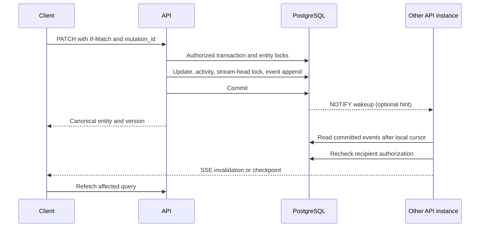

# Realtime synchronization

Selected: REST mutations, SSE invalidations and a durable PostgreSQL replay log. [ADR-004](adr/004_REALTIME.md), [database](DATABASE_DESIGN.md), [API](API_DESIGN.md).

## Evaluation

| Option | Useful properties | Limits | Decision |
| --- | --- | --- | --- |
| WebSockets | Duplex transport for presence/CRDT operations | More connection, backpressure and auth machinery; delivery still needs persistence | Reserve for M14 collaborative text |
| SSE | HTTP server-to-client stream; fits notifications and invalidations | HTTP/1 connection limits; bearer headers need fetch streaming; proxy buffering must be disabled | Core transport |
| PostgreSQL LISTEN/NOTIFY | Lightweight multi-process wakeup after commit | Non-durable; payloads visible to DB listeners; connection state must be maintained | Hint only, no content payload |
| Redis pub/sub | Efficient cross-node fan-out | At-most-once delivery and another service | Optional later wakeup bus, never replay store |
| Polling | Simple, survives proxy restrictions | More queries and latency | Two-second server safety poll; client 15-second degraded fallback |

These transport facts are grounded in [PostgreSQL NOTIFY](https://www.postgresql.org/docs/current/sql-notify.html) and [Redis delivery semantics](https://redis.io/docs/latest/develop/pubsub/). Product ordering and recovery rules below are OpenTrack's design.

## Commit order without skipped events

A database sequence is not a safe replay cursor: transaction A may reserve 10, B reserve 11 and commit first; a reader advancing to 11 would miss A. Instead each workspace has a stream-head row. A command locks its aggregates first, then locks that head LAST, increments its transactional last_seq, inserts the event and commits promptly. Another writer cannot receive a higher workspace sequence until that lock is released at commit/rollback. On rollback the increment rolls back. Multiple events in one command reserve a contiguous range.

No request obtains the head lock and then waits for another aggregate lock, provider, file read or user decision. The authorization guard is acquired before aggregate locks. This serializes the short append/commit tail per workspace, not the full request computation. Benchmark contention and p99 write latency; a CDC-based alternative requires an ADR if the budget fails. PostgreSQL failover preserves committed WAL according to the deployment durability settings; no application promise exceeds the chosen replication RPO.

Each API node tails the replay log for workspaces with subscribers; it does not compete with other nodes to consume events. A dedicated LISTEN connection triggers a read, and a two-second poll catches lost notifications. Notifications contain only a workspace hint or a global wake flag. The durable row supplies all event content. App workers have independent receipts/checkpoints for notifications, automation and search extensions.

## Retention and consumer recovery

Seven days is the browser replay guarantee and cursor lifetime, not permission to discard uncaptured work. Purge only events older than that window whose sequence is no greater than every enabled required consumer's durable checkpoint. A consumer advances after its effect or a durable downstream job/delivery record commits with the receipt. A failed event can advance only after a durable dead-letter record containing the minimal authorized recovery payload is created, alerted and assigned an explicit disposition; a log line is insufficient.

Required consumers are versioned deployment registrations. Enabling a new consumer declares a start cursor and any necessary snapshot backfill; disabling one requires an audited drain or disposition, never silently removes its retention protection. A stalled consumer raises lag and disk-pressure alerts. Do not silently drop its backlog to reclaim disk: stop accepting affected writes at the storage safety threshold if needed, then repair/drain or explicitly rebuild a replayable projection. Email, webhook and automation intent already captured in their own tables retains its independent retry policy. Browser cursors still expire after seven days even when older rows are retained for workers.

Test a worker outage longer than the replay window, a poison event, disabled/re-enabled consumer, disk pressure and a newly registered consumer. Confirm no required effect vanishes and browser reset remains bounded.

## Event contract

Wire event has event_id, schema_version=1, type, workspace_id, entity_type, entity_id, entity_version, actor_id only when readable, occurred_at, mutation_id, and changed_fields without old/new text values. Types include issue.created, issue.updated, issue.deleted, document.updated, project.updated, notification.created, access.changed, agent_run.updated. The SSE id is an opaque authenticated/encrypted cursor containing workspace, principal, permission epoch, sequence and expiry. It is not a bearer credential and does not grant access.

Only events whose entity the recipient may read are emitted. Hidden events still advance the internal scan cursor; periodic checkpoint events contain only the opaque cursor so a client does not replay an endless forbidden range. Do not expose titles, descriptions, email addresses, private team IDs or forbidden entity IDs. Access.changed for the affected user tells the client to clear affected workspace state and bootstrap again; it must not disclose membership changes in unrelated private teams.

Ordering is per workspace committed sequence, not across workspaces. Delivery is at least once while the cursor is retained. There is no exactly-once claim. Entity versions decide freshness; duplicate event IDs can be ignored. Projection messages may arrive later than entity changes. Wall-clock timestamps are for display, not ordering.

## Bootstrap and reconnect

1. GET /bootstrap uses a short REPEATABLE READ snapshot to return membership epoch, sidebar, initial authorized query data and the stream head from the same snapshot. Do not hold this snapshot for later pagination.
2. Subscribe to /events with that cursor. Replay seq > cursor in bounded pages, then tail. New query responses may already include later versions; apply no event patch that regresses them.
3. On normal reconnect send Last-Event-ID (or equivalent fetch-stream header), using jittered 1/2/4/8/15/30-second delays. Heartbeat every 15 seconds; reconnect after 45 seconds without traffic.
4. After cursor expiry, workspace mismatch or changed permission epoch, the endpoint returns 409 cursor_expired/access_changed before streaming. The client clears cached data for that scope, re-fetches bootstrap and starts again. Native EventSource has limited error body access; a status/bootstrap request resolves the reason.
5. If more than 10,000 events must replay, return reset_required and bootstrap. A single client queue holds at most 256 events or 1 MiB; slow consumers disconnect with a recoverable reason rather than grow process memory.

No full database copy is synchronized to the browser. Active views refetch selectively; offscreen queries become stale. One connection per tab/workspace is acceptable initially with a three-connection per-session cap; later SharedWorker multiplexing is optional. HTTP/2 is recommended. Logs/conversation deltas share a separate bounded multiplexing channel or are fetched on demand; do not open a stream per issue.

## Optimistic writes and conflicts

A mutation snapshots only the affected cache entry, tags its provisional change with mutation_id, and serializes local writes to the same entity. On success replace with canonical response, then invalidate lists whose membership or ordering may change. A matching event acknowledges rather than reapplies the optimistic mutation. If another event arrives while a local mutation is pending, preserve the draft and refetch after settlement; never overwrite a newer optimistic layer with an old response.

412 shows changed fields and the current server version; the user chooses their draft, server values or an explicit merge before a new request. Rich-text conflicts preserve both documents in an accessible diff/compare view; no automatic last-writer-wins. Undo is a fresh authorized command against the latest version, not a rollback of database history.

Offline mode is read-only with an offline banner. New issue/comment drafts may be retained in session storage after explicit user choice, keyed by user/workspace and purged on sign-out. Do not queue silent writes while disconnected. Character-level simultaneous editing, cursor presence and durable offline operations require a separate CRDT migration and are M14, not a claim of MVP realtime collaboration.

## Security, observability and tests

Check session expiry/revocation and current access before every event emission, with batched membership reads under a short read transaction. Also revalidate on each 15-second heartbeat; active revocation triggers immediate connection closure where possible. New reads/writes consult current authority, not a stale per-node membership cache. A bounded in-flight already-authorized response may complete; revocation cannot retract delivered bytes.

Measure commit-to-delivery p95, oldest replay event, queue depth, reconnect/resync rate and per-node subscriber count; never use entity/user IDs as metric labels. Required tests: reversed commit timing, rollback gap, lost NOTIFY, listener reconnect, two API nodes, hidden-event checkpoint, expired cursor, revoked team/session, response/event race, repeated mutation, slow subscriber, shutdown, and client cache clearing after account/workspace switch.

## Expansion event registration

Add initiative.updated, outcome.observed, planning_scenario.updated, capacity.updated, personal_work.updated, reminder.updated, checkin.updated, retrospective.updated, retro_round.updated, decision.updated, feedback.updated, release.updated, review_request.updated, incident.updated, report.updated, template_run.updated and custom_field.updated as versioned invalidation families. Event payloads remain minimal source references/changed-field names, never raw card text, hidden author IDs, contacts, private draft bodies or scenario source snapshots.

Every family registers an owner-specific read predicate. A team predicate alone is insufficient for retro/session membership, personal rows or reports with current source ACL. Query consumers reauthorize each source; no background consumer can expand audience. Retro vote count updates must not reveal other participants' allocations before the configured round reveal. Source revocation purges affected scenario/report material from client caches and requires rebootstrap under the new permission epoch. Mutation+activity+event append remains one transaction; batch scenario apply reserves one contiguous event range after source edits are locked.

Register projection/backfill and retention requirements before enabling report/reminder/template consumers. New subscribers must not skip durable work merely because a module was hidden in navigation. Test replay after source revocation, hidden author events, duplicate action/template messages and a consumer outage beyond the browser replay window.
