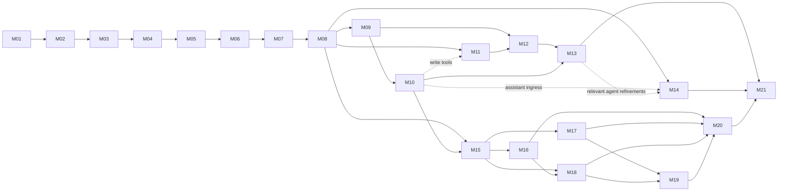

# Dependency-aware implementation roadmap

Implementation of the complete baseline and 66-capability expansion is explicitly authorized. M01–M08 remain a core release boundary, not completion of the goal. M09–M21 are also in scope; AI remains optional at runtime. Status and proof belong in [REQUIREMENTS_STATUS](REQUIREMENTS_STATUS.md); the dependency strategy is in [IMPLEMENTATION_PLAN](IMPLEMENTATION_PLAN.md).

| Milestone | Dependencies | Release | Tasks | Plan |
| --- | --- | --- | --- | --- |
| M01 Foundation and executable contracts | None | MVP foundation | 6 | [Detailed tasks](milestones/M01_FOUNDATION.md) |
| M02 Authentication, workspaces and isolation | M01 | MVP | 6 | [Detailed tasks](milestones/M02_IDENTITY.md) |
| M03 Issue management vertical slice | M02 | MVP | 6 | [Detailed tasks](milestones/M03_ISSUES.md) |
| M04 Editor, comments, attachments and templates | M03 | MVP | 6 | [Detailed tasks](milestones/M04_COLLABORATION.md) |
| M05 Projects, milestones, cycles and board | M04 | MVP | 6 | [Detailed tasks](milestones/M05_PLANNING.md) |
| M06 Search, saved views and realtime | M05 | MVP | 6 | [Detailed tasks](milestones/M06_DISCOVERY.md) |
| M07 Notification delivery and inbox | M06 | MVP | 5 | [Detailed tasks](milestones/M07_NOTIFICATIONS.md) |
| M08 Core MVP release and recovery | M07 | MVP release | 6 | [Detailed tasks](milestones/M08_HARDENING.md) |
| M09 GitHub repository and pull request links | M08 | Integration release | 5 | [Detailed tasks](milestones/M09_GIT.md) |
| M10 Public tokens, outbound webhooks and rules | M09 | Integration release | 5 | [Detailed tasks](milestones/M10_AUTOMATION.md) |
| M11 Optional provider connections and conversations | M08; M10 for write-tool integration | AI preview | 6 | [Detailed tasks](milestones/M11_AI.md) |
| M12 Isolated agent execution and patch delivery | M09, M11, M08 recovery | Agent preview | 6 | [Detailed tasks](milestones/M12_RUNNERS.md) |
| M13 Human review and draft pull requests | M12, M10 | Agent release | 5 | [Detailed tasks](milestones/M13_PUBLICATION.md) |
| M14 Advanced planning, collaboration and desktop | M08; M10–M13 only for related tracks | Long term | 6 | [Detailed tasks](milestones/M14_ADVANCED.md) |

## Approved expansion milestones

These append to the stable M01–M14 sequence. M15 may proceed alongside M11–M14 after its own core/integration prerequisites pass. F16 roadmap delivery is completed with M16; M14 retains the original advanced-platform and collaboration tasks. M21 depends on both branches and cannot declare the whole product complete from the core branch alone.

| Milestone | Dependencies | Tasks | Plan |
| --- | --- | --- | --- |
| M15 Workspace customization and shared expansion primitives | M08, M10 | 5 | [Detailed tasks](milestones/M15_WORKSPACE_EXPANSION.md) |
| M16 Initiatives, roadmap scenarios and capacity | M15 | 4 | [Detailed tasks](milestones/M16_PLANNING_EXPANSION.md) |
| M17 Retrospectives, personal planning and team routines | M15 | 5 | [Detailed tasks](milestones/M17_RETROS_ROUTINES.md) |
| M18 Decisions, feedback and maintained knowledge | M15, M16 | 4 | [Detailed tasks](milestones/M18_DECISIONS_FEEDBACK.md) |
| M19 Releases, reviews and incidents | M09, M10, M17, M18 | 5 | [Detailed tasks](milestones/M19_RELEASES_INCIDENTS.md) |
| M20 Reports and connected product workflows | M16, M17, M18, M19 | 4 | [Detailed tasks](milestones/M20_REPORTS_WORKFLOWS.md) |
| M21 Complete-product qualification | M13, M14, M20 | 5 | [Detailed tasks](milestones/M21_QUALIFICATION.md) |

## Execution strategy

Use vertical increments: schema/command/API/UI/negative-access test together. M01 builds a tiny reproducible contract slice; M02 proves identity/isolation; M03 delivers real issue creation before advanced planning. Do not implement all tables or UI shells upfront. Rich editor, planning, discovery and inbox follow existing usable flows. Each milestone file gives scope, dependency prerequisites, task-level done conditions, tests, risk and completion criteria. Feature dependency lists describe domain relationships, not a requirement to finish every linked feature first: M03 includes atomic activity, durable events and a scoped picker lookup; M04 adds discussion UI; M06 adds full search/realtime consumers. Authorization, schema and command prerequisites ship in the same vertical slice rather than waiting for a later administration screen.

Current dependency research establishes candidate runtime/package compatibility, not a resolved build. M01 closes toolchain/generator/component uncertainties. Security and data integrity are prerequisites throughout, with M08 completing operator/recovery/performance/accessibility evidence rather than postponing all hardening until the end.

M09/M10 and read-only M11 can progress independently after M08; write tools depend on M10 contracts. M12 cannot skip Git grants or provider authentication. M13 cannot bypass runner isolation because publication is convenient. M14 is a set of independent gated tracks, each with its own ADR and validation, not a promise of simultaneous delivery.

## First implementation milestone

Execute M01 Foundation and executable contracts: pinned toolchain/dependency evidence, typed TOML settings, a real Rust API/static React path, generated contract, accessible primitives and reproducible checks. Record its evidence, then continue into the next dependency-ready milestone. Passing M01 does not establish authentication or issue completion and is not an instruction to stop the goal.

## Release completion and sequencing risk

For every milestone link actual command/test results, environment, migrations, screenshots where applicable and remaining limitations. An owner reviews changed ADRs and unresolved gates before release. Dependency/API drift, provider eligibility, security isolation, license/name decisions and available maintenance capacity remain explicit risks. No calendar estimate is invented without staffing/capacity information; task breakdown supports estimation later.
