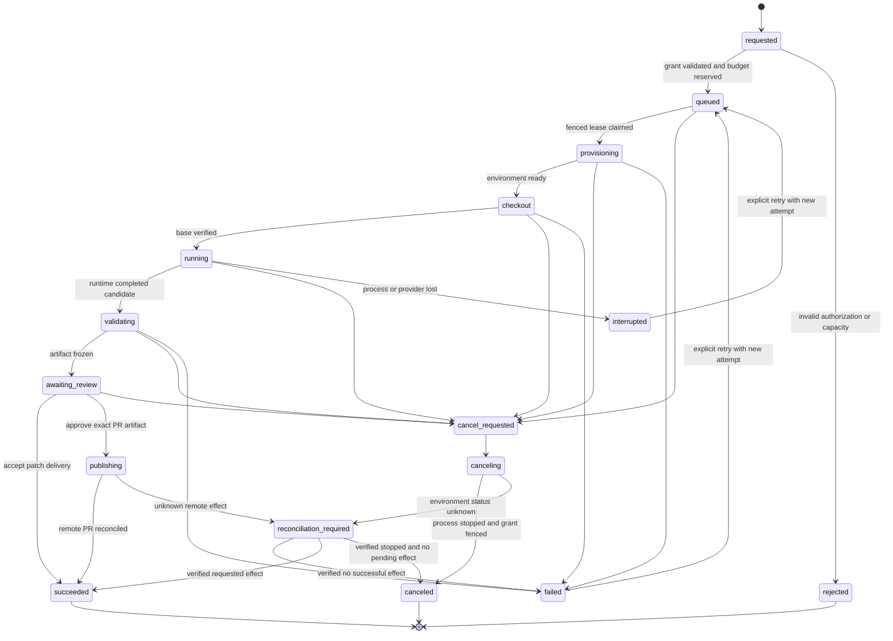

# Agent lifecycle and recovery state machine

Canonical states apply to the run's current attempt; immutable attempt records retain every previous outcome. Core jobs can retry orchestration without authorizing repeated arbitrary execution. [Execution](AGENT_EXECUTION.md), [security](AGENT_SECURITY.md).

Publication cancellation also transitions to cancel_requested, but cannot promise to undo a remote PR already created. The controller first fences further effects, then reconciles whether publication occurred; cancel_requested during an external operation may end succeeded with a clearly recorded cancellation-arrived-too-late result, or canceled after known no effect. A denied review can end failed with reason review_rejected. The diagram omits repetitive failure/cancel edges from every nonterminal state; the transition table is authoritative.

| State | Durable evidence / permitted next step | Recovery rule |
| --- | --- | --- |
| requested | Request identity, issue/repo/base intent, grant snapshot | Validate current authority; reject with reason or reserve/queue |
| queued | Attempt number reserved, immutable spec, budget/priority | Claim with lease; may cancel without spawning |
| provisioning | Runner ID, environment ID, fence, deadline | Inspect existing environment for same attempt before create; no duplicate launch |
| checkout | Base SHA verified, clone status | Failure is safe before code executes; explicit or bounded preparation retry |
| running | Runtime session ID if available, heartbeat, log sequence | Lost contact fences credentials; do not start a replacement until old environment stopped/quarantined |
| validating | Candidate revision and test manifest in progress | Test interruption recorded; no implied pass; retry requires explicit plan |
| awaiting_review | Frozen diff/head/base/test/policy digests | Process can be stopped; artifact remains immutable; approvals expire |
| publishing | One-use approval consumed, external operation marker | Resolve remote outcome before retry; never repeat based on timeout alone |
| cancel_requested / canceling | Who canceled, time, reason, revoked broker grant, termination attempts | Do not mark canceled while child/remote effect status remains unknown |
| interrupted / failed | Cause, last known revision, partial artifacts, cleanup state | Explicit retry creates attempt N+1 with fresh scope check; old attempt remains immutable |
| reconciliation_required | Ambiguity reason, operation/environment identifiers | Controller/operator checks factual state; no speculative success or blind replay |
| succeeded | completion_kind patch/pr, artifact ID, exact tests, optional verified PR ID/URL | Succeeded means requested delivery produced, not merged/deployed or bug scientifically proven fixed |
| canceled / rejected | Final cleanup and permission evidence or rejection reason | New request needed for canceled/rejected run; history remains readable subject to access |

## Lease and fencing protocol

Core claim transaction uses SKIP LOCKED, sets lease_owner and a newly generated fencing generation, increments attempt claim metadata and commits before dispatch. Runner acknowledges attempt ID/spec digest/fence. Renew every 20s with 60s expiry. Controller rejects stale generations for logs that claim state transitions, artifact finalization, finish and broker requests; late logs may be retained as explicitly stale evidence without altering the current state.

A database fence alone cannot stop a zombie shell. Broker credentials expire with lease, supervisor has a local deadline, and a host watcher terminates an environment when lease cannot renew. Do not reassign active work until the old environment is confirmed stopped or its host is quarantined and unable to perform external writes. Reclaiming a job is not proof that a process died. Attempt execution is at most one active acknowledged environment under normal operation; failures require reconciliation rather than an exactly-once promise.

## Crash and retry matrix

| Failure point | Required result |
| --- | --- |
| Controller before queue commit | No accepted run; retry same idempotency key |
| After commit, before runner dispatch | Queue survives; same attempt is dispatched once by fenced claim |
| Runner receives spec, ACK lost | Controller reconciles by attempt/environment ID; runner treats duplicate spec as same environment |
| Controller restart during run | Runner keeps bounded local execution only while lease can be renewed; new controller reconstructs DB state |
| Runner host disappears | Fence broker, mark interrupted/reconciliation; quarantine host before retry |
| Test exits nonzero | Failed validation; preserve patch/logs; no publication approval unless policy explicitly allows reviewed nonpassing evidence, never label tests passed |
| Artifact upload partial | Remains unready; resend verified chunks; no review approval for partial digest |
| Approval after new head/policy | Reject stale approval; require fresh review |
| PR create response lost | Query existing PR/branch/operation marker; record remote ID before declaring success |
| Cancel while test spawns grandchildren | TERM group, wait 10s, KILL remaining group/VM, verify no process remains; unknown => reconciliation |

Infrastructure preparation may retry at most 3 times before repository code runs if environment creation is idempotent. Model/tool execution and publication are not covered by that safe retry rule. A user-requested retry revalidates issue version/context, repository base, provider credentials, current permissions and budget, then creates a new attempt. Resume a provider conversation only when the pinned adapter documents it and the original environment/artifact identity is preserved; otherwise start a new session and label it.

## Acceptance scenarios

Kill each component at every state boundary; verify no duplicate publish, no inaccessible artifact, no lost cancellation intent and no success without terminal evidence. Run two schedulers/three runners against one queue; renew with old fence after lease replacement; cancel during publication; expire approval; change base SHA; restore controller DB from backup with dispatch disabled. Record expected state and observed external effect independently.
