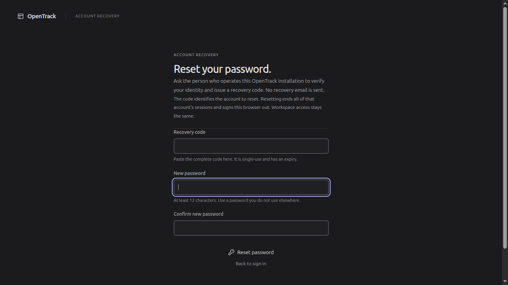
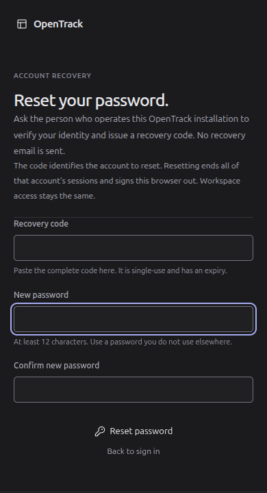

# Offline account recovery checkpoint — 17 October 2026

This increment follows session checkpoint `515a510`. It adds operator-issued local password recovery to the real Rust/PostgreSQL application. It does not complete M02 or the product; global disablement, privilege-elevation rotation, OIDC and the remaining identity gates are separate work.

## Behavior and authority

The public `/recover` form accepts a manually delivered code, new password and confirmation. It works independently of session/workspace startup, supports password-manager values and paste, and keeps credentials out of URLs and browser storage. Only an empty successful `204` shows completion. A lost or unexpected response is explicitly uncertain; retry retains the same submission and does not imply that a used-code error proves failure. Successful completion signs this browser out without logging in automatically or changing memberships.

A separate local operator login can issue and revoke recovery through two narrow database functions. The serving process has no issuance route or operator credential. CLI preflight rejects elevated roles, table/sequence access, ownership, schema creation, role memberships and missing function grants. Runtime startup rejects elevated or recovery authority reachable directly or through role membership. The database functions have fixed schema-qualified search paths, retain FORCE RLS, capture the real database session identity, and require atomic audit insertion. Runtime SQL cannot manufacture a recovery token or an operator audit entry.

The code has 256 random bits and a public account UUID; PostgreSQL stores only its digest. One pending code is allowed per account. Default lifetime is 30 minutes, configurable from 5 to 60 minutes. Issuance writes a new `0600` file before activating the code. Descriptor-relative traversal rejects symlinks and unsafe ancestors; output contains receipt metadata rather than the bearer. An uncertain database outcome retains the private file and instructs explicit reissue or revocation.

Completion validates the code before expensive hashing, releases the transaction during password hashing, then locks the account exclusively and revalidates the code. Password replacement, code consumption, other-token invalidation, all-session revocation and audit commit together. Login checks the password hash again under the same account guard. Old cached actors cannot write after recovery wins the guard.

## Verification record

Environment: Linux, Rust 1.98.1, PostgreSQL 18.6 on isolated loopback port 55432, Node 22.22.1 and npm 10.9.4. Runtime, migration and operator credentials are distinct. Database integration tests use fresh schemas in the separate test database.

The final `scripts/check.sh` completed successfully with 40 Rust tests, 70 frontend tests across 9 files, and 3 Python credential-upgrade regressions. Rustfmt, strict Clippy, isolated test migrations, generated OpenAPI/TypeScript drift checks, TypeScript and the production Vite build passed. The clean run is recorded locally in `work/check-recovery-qualified.log`. An earlier successful check had its log overwritten by an accidentally concurrent check; that duplicate was stopped and the complete check repeated with a separate log. The clean run includes the final same-code race and explicit sign-in route.

Real PostgreSQL application tests exercise invalid/expired/replaced/revoked/disabled/used codes, rollback on audit failure, operator capability separation and account fencing against login/writes in both lock orders. A restrictive test-only barrier admits both concurrent consumers past the preliminary check; observed database lock waiters then prove exactly one consumes the code, with one completion event and only the winning password accepted. HTTP contracts prove old cookies fail, the new password works, Origin/JSON/password validation, secure cookie clearing, uniform errors, no-store and forwarded-header-resistant throttling. Subprocess CLI tests verify private files, refusal before output creation, redacted output, uncertain issuance rollback, replacement and explicit revocation.

Fresh CI-style provisioning with three generated roles, migration and the URL-file grant command passed against real PostgreSQL. A rehearsal caught and fixed incorrect use of a connection URI in `PGDATABASE`; the helper now parses the constrained generated URI into separate libpq environment fields without a secret in argv. Ten scratch deployment-secret checks and default/operator Compose rendering passed, including preservation of prior secret hashes and modes. Containers were not built or executed. Cargo audit checked 244 dependencies with no findings; actionlint, shell/Python syntax, Git whitespace and 552 modified-document local links passed.

Independent review identified and fixed three gaps before qualification: replication privilege was omitted from operator checks; NOINHERIT membership could still permit `SET ROLE`; and checking an output directory by pathname left a rename/symlink race. Native probes using fresh temporary roles confirm rejection of operator replication and role-reachable table access before file creation, and refusal to serve with direct replication or reachable CREATEROLE. Temporary roles and grants were removed. The probe's first runtime assertion used an incorrect expected log phrase; correcting that assertion produced a passing replay, with no production-code change needed.

## Browser and running server

Migration 0006 was frozen and applied to the development database after a private local dump at `work/postgres/before-0006.dump`. This dump is not restore-qualified. Explicit operator grants succeeded and were safely repeated. The server at loopback port 18970 returned ready after restart. An actual HTTP request with an invalid code returned `422 recovery_invalid` and `Cache-Control: no-store`.

The in-app browser rendered `/recover` at desktop width and at 390×720. The mobile document width stayed 390px. Focus started on the recovery code, Tab reached both password fields and the reset action, and an empty submit returned focus to the required code field. Review found that linking an uncertain result to `/` could restore an existing cookie instead of checking the proposed password. All recovery sign-in links now open `/signin`, which always requires credential entry and does not run session bootstrap. The live browser confirmed that this form appears despite an existing valid session. Component regressions cover failed verification, returned-session routing with/without a workspace, and stale bootstrap/login cancellation. A live route check also caught a stale browser title; the sign-in/setup screen now sets its own title. Frontend tests/build passed again after that title fix. Browser warning/error logs were empty during the initial responsive check.

No new password was entered or submitted through the live browser: the browser-control policy reserves credential changes for a user handoff. Actual reset behavior is verified through real database/API contracts; frontend success/error/autofill paths are exercised separately by component tests. These are distinct from a completed live-browser reset rehearsal.

## Operations and remaining gates

See [account security](../ACCOUNT_SECURITY.md), [configuration](../configuration/IMPLEMENTED_SETTINGS.md) and [runtime setup](../RUNTIME_SETUP.md). Migration 0006 extends account audit while preserving existing session events. Applied migration files must not be edited. No downgrade compatibility, token-retention worker or whole-product restore has been qualified by this increment.

F02-A3's second-owner recovery requirement remains unverified because workspace ownership alone cannot authorize changing a global identity used by unrelated workspaces. This implementation follows F03's explicitly separate local-operator authority; it does not reinterpret that unresolved requirement. SMTP delivery, global disable/enable, elevation rotation, OIDC and complete deployment qualification remain open.
