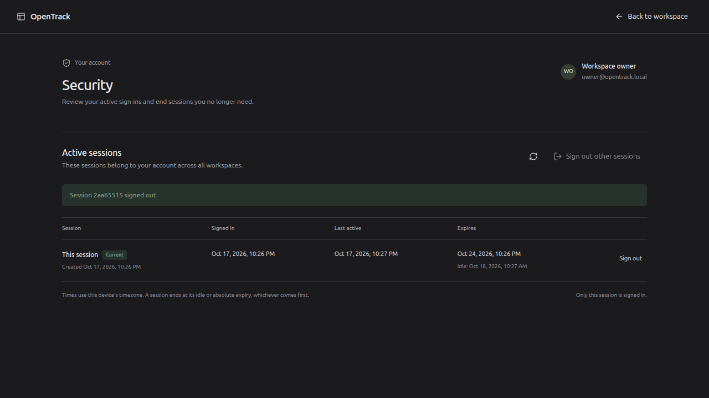
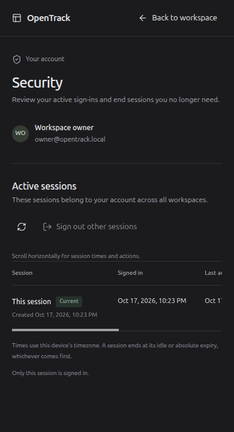

# Account session checkpoint — 17 October 2026

This increment follows configuration commit `ffe36ed`. It implements account-wide session management, login/invitation rotation and account audit integrity. Recovery, global disablement, privilege-elevation rotation and the complete M02 release gate remain unfinished.

## Implemented behavior

`/account/security` is reachable from the account menu and the no-workspace screen. It lists active own sessions with timestamps and a current marker, supports bounded pagination, individual revocation, current sign-out and revoking every other active session. Public UUIDs are independent of bearer-token hashes. Writes require Origin and CSRF; revoking another session additionally requires recent password authentication.

Login rotates a prior same-account cookie. Failed login preserves it; signing into another account does not revoke that other account's cookie. Existing-account invitation acceptance rotates the cookie while preserving its password authentication time and absolute expiry. New-account creation and password login establish fresh values. Freshness uses the current database clock after lock acquisition.

Ordinary commands acquire a shared user guard before the workspace guard and recheck session validity. Session mutations take the exclusive user guard directly, without upgrading. Security effects and account audit commit together. An insertion ownership check validates public session references without a durable foreign key to expiring credential rows. Runtime grants and triggers prohibit audit rewriting.

Session cursors have SHA-256 HMACs bound to account, current session, page size and a signed 24-hour lifetime. Wrong scope, tampering, future issuance and expiry fail. Setup-secret rotation invalidates cursors, not existing sessions. Older workspace directories still require their full signed/expiring cursor work.

## Executed checks

The shared `scripts/check.sh` passed with final backend/frontend sources on Linux, Rust 1.98.1, PostgreSQL 18.6, Node 22.22.1 and local npm 10.9.4. Runtime and migration identities remained separate; integration tests used isolated schemas in the dedicated test database.

- **31 Rust tests:** 24 unit and 7 real-PostgreSQL integration tests; zero failed or ignored.
- **52 frontend tests across 8 files:** pagination, reauthentication retry, wrong-password preservation, stale responses, zero-workspace access and final focus restoration.
- Formatting, all-target workspace Clippy with warnings denied, migration, generated OpenAPI/TypeScript drift, TypeScript and Vite production build passed. The frontend consumes generated session DTOs.
- New App/API contracts cover own/foreign IDs, bounded pagination, credential exclusion, CSRF/Origin rejection, no-store/problem responses, secure-cookie clearing, expiry, stale actors and idempotent revocation.
- Both revoke/write orderings were established through `pg_blocking_pids`: an earlier authorized write commits first; a write queued behind revocation rechecks and fails without creating an issue.
- Invitation regression: authentication older than ten minutes rejects without consuming the invite or revoking its source session. Recent authentication allows acceptance while preserving exact `auth_time` and `expires_at`; aging the replacement still requires reauthentication.
- Audit RLS, forged session-reference rejection and UPDATE/DELETE/TRUNCATE defenses passed. Re-running development setup preserved denied audit mutation privileges for both runtime roles. CI bootstrap has the matching safeguard.
- Refreshed RustSec audit: 244 dependencies, zero vulnerabilities/warnings; database revision `999ec89d5d3f10f20be14750ec8c2d8b44e0ac9b`. Actionlint and modified Python/Bash helper syntax passed. Hosted CI and container execution were not performed.

Full output is in ignored `work/check-sessions-final.log`; source hashes and additional results are in `work/session-verification.md`. Final assets measured JS 319.74 kB (94.88 kB gzip) and CSS 34.68 kB (7.09 kB gzip), not runtime performance qualification.

## Browser and native verification

The native server ran at loopback port 18970 against the real development database. Migration 0005 was applied after a private local dump; the dump was not restore-qualified. Existing workspace/team data remained accessible after restart.

The in-app browser opened Account security through the account menu. A naturally aged session was denied revocation, then password confirmation refreshed the current marker without replaying the action. Individual and bulk revocation removed the intended rows. Current sign-out returned to login, and signing in restored the account page.

The final focus fix was replayed using controlled local fixture timestamps and a separate test session. After password confirmation and list refresh, the active DOM element was **Refresh sessions**. Revoking the other session through the UI was independently checked with its captured test cookie: the live API returned `401 unauthenticated`.

Mobile testing at 390×720 initially exposed an absolutely positioned hidden header escaping its scroll container (document width 644px). Positioning the container fixed it: document and viewport both measured 390px; the 690px table remained within its 350px scroll region. Keyboard Tab reached the offscreen sign-out button and scrolled the region to it. Final browser warning/error logs were empty; the native server emitted no unexpected warnings/errors during the replay.

## Operations and limits

See [account security](../ACCOUNT_SECURITY.md). Migration 0005 is additive and applied locally; do not edit it. Rollback requires the matching database backup and binary. Existing sessions receive IDs without fabricated creation history. Automated credential-row/audit retention, recovery, global disablement, privilege-elevation rotation, OIDC and remaining identity gates are pending. This checkpoint does not complete the product.
