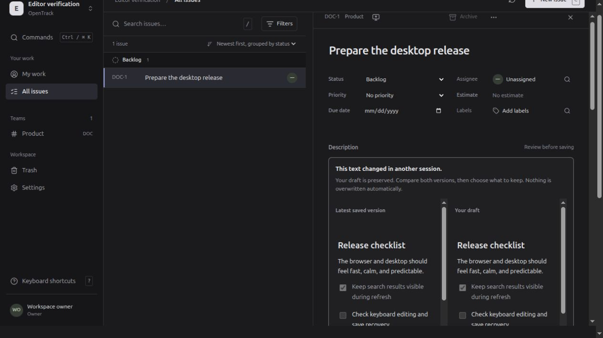

# Document editing and discussion — 18 October 2026

This M04 increment adds versioned issue descriptions and comments to the existing browser and desktop application. The increment is deployed locally with a matching Linux package. The evidence below establishes individual checks, not completion of M04 or the whole product.

## Implemented behavior

The lazy-loaded Tiptap editor supports headings, inline formatting, lists and checklists, quotes, code blocks and safe links. Description autosave waits 750 ms and pauses during IME composition. Explicit save, unsaved-navigation handling, interrupted-response reconciliation and two-version conflict review preserve the local draft. Keeping a draft after conflict requires an explicit save. Body acknowledgments preserve the editor instance and caret; body-only updates do not refresh the issue list.

Rust validates schema-versioned JSON, derives plain text and limits new writes to 256 KiB, depth 32 and 10,000 nodes. Document versions are independent of issue metadata versions; issue ETags include the current body version. Initial issue/body creation and required activity, audit and events commit atomically. Migration 0016 preserves legacy text, including content whose JSON encoding exceeds the new-write limit. Unsupported content has a read-only fallback.

Comments have idempotent creation, versioned editing, author/moderator permissions, moderation reasons, paginated tombstones and permalinks. Current issue access and the original team audience govern historical comments and revisions after moves. Deleted comments have an empty canonical body; prior revisions remain subject to the 90-day history policy. The restricted worker prunes expired, superseded revisions with mandatory retention audit.

## Completed automated and process checks

| Check | Observed result and local evidence |
| --- | --- |
| Application contracts | Ten document/discussion tests passed in the final backend run (six document, four discussion), including bounded large-comment pages. Earlier focused runs below qualified the first nine cases. Coverage includes hostile JSON, independent versions and conflicts, real competing-save lock ordering, private access after moves/revocation, moderation, idempotency, pagination, required-effect rollback, genuine schema 15→16 migration and restricted retention. Logs: `work/test-documents-discussion-ux-r2.log`, `work/test-document-atomicity-ux-r3.log`, `work/test-document-concurrency-ux-r1.log`. The initial atomicity failure exposed a missing required `document.created` audit; the targeted rerun passed after correction. |
| HTTP contract | `independent_documents_and_idempotent_discussion_over_http` passed against real PostgreSQL: `work/test-documents-http.log`. |
| Native core and boundary checks | 33 passed: 12 unit, one GLib regression and 20 boundary tests, including explicit document routes and bounded legacy-body responses. `work/documents-native-qualified.log`; strict native Clippy also completed in `work/documents-native-clippy-qualified.log`. Document read responses allow at most 4 MiB to cover escaped grandfathered text plus its plaintext projection; other response limits remain unchanged. This is not native GUI evidence. |
| Final frontend run | 273 tests across 31 files passed in `work/test-documents-web-root-final.log`; TypeScript and the isolated production build passed in `work/build-documents-web-qualified.log`. Tests include deferred search results, three focus-recovery cases, real Tiptap caret/acknowledgement and comment-clear behavior, draft guards, conflicts and metadata/body save serialization. |
| Isolated real process | `work/documents-process-result.json` records schema-15 rejection by the new server/worker, migration and restricted grants, rich-body conflict behavior, idempotent comment creation, revision/activity pagination and an actual worker cycle. This used `opentrack_ui_0016_20261018` at loopback port 18972; the receipt records no mutation of the main or restore-proof database. |

The schema-15 recovery snapshot at `work/postgres/before-0016-snapshot.dump` was restored into `opentrack_restore_0015_snapshot_20261018`. Its receipt confirms consistent source snapshot fingerprints, 42 data/sequence entries, and matching table ownership, RLS, ACLs and function ownership/search paths. The preserved schema-15 binary and assets passed the eight-check HTTP recovery receipt on port 18971, including readiness, matching assets, login, bootstrap, stored issue identity/version and logout. No migration ran during this proof; the owned server stopped afterward. Receipts: `work/postgres/restore-before-0016-snapshot-result.json` and `work/restore-before-0016-http-result.json`.

## Browser observations

Live checks used the isolated schema-16 application at `http://127.0.0.1:18972`, not the main development database:

- Checklist checkboxes and text aligned after correcting the rendered task-item selector.
- Extra typing without targeting the editor again continued at the same cursor after autosave.
- Ctrl+Enter posted a comment once and cleared the composer in the rebuilt UI.
- Searching from an open issue retained focus after the 280 ms debounce; further untargeted typing continued in search. Rows remain during pending same-authority queries.
- The final layout had root scroll height 720 px for a 720 px viewport, removing the accidental outer scrollbar. Connections remain mounted during body saves.
- Concurrent remote and local description edits displayed both versions. “Keep my draft for review” retained local text and required explicit save.

## Final backend verification and deployment

The full matrix passed across the original run and two resumptions: **103 distinct Rust tests**, **11 Python deployment checks**, workspace formatting and all-target Clippy, generated API consistency, and the final server build. Two older upgrade fixtures needed explicit current-schema expectations for body_version 1 and its derived ETag; exact 14→15 and 11→12 comparisons and persisted receipt bytes remain verified. Logs: `work/check-documents-backend.log`, `work/check-documents-backend-resume.log`, `work/check-documents-backend-resume2.log`, `work/test-assignment-upgrade-document-compat.log`, `work/test-graph-upgrade-document-compat.log`.

Immediately before deployment a fresh 294,472-byte archive was restored into `opentrack_restore_0015_doc_deploy_20261018`. All 42 data/sequence fingerprints and authority comparisons passed, followed by eight preserved-build HTTP checks. The rollback point is `work/postgres/before-0016-deploy-final.dump` plus `work/rollback-before-0016/`. Rollback requires restoring the schema 15 database with its old binary/assets; running the old binary alone against schema 16 is not a supported downgrade.

The verified old supervisor stopped only its API and worker. `scripts/dev.sh` applied 0016, refreshed worker grants, built the frontend and started the new services; operator grants were refreshed separately. Readiness is 200; the issue/document projections are consistent; both live child executables match the qualified build and carry only their separate serving/setup or worker credentials. Both workspaces report zero dead letters and failed cleanup jobs. Receipt: `work/deployment-0016-result.json`.

The main browser reloaded ENG-5 with its owner assignment and Browser review label retained, the new editor/comments visible, and no captured warning/error logs. No main issue content was changed by these UI checks. [Updated main workspace](2026-10-18-documents-main-workspace.png). The isolated test tab/API were closed afterward; their database remains available for evidence.

## Linux package and saved connection

`OpenTrack_0.1.0_amd64.deb` is 8,604,442 bytes, SHA-256 `0a6de3aa73ee535213654812ed2de8b5111acd1e1d174450df6ccd36da0bfd40`. All seven embedded frontend assets match the qualified build, allowing only equivalent source-map paths and Tauri HTML normalization. Debian marker, launcher, URI forwarding and icon checks passed; installation was atomic and retained the connection configuration.

The earlier native process had already exited before installation; no process was killed by the installer. The updated installed binary was launched directly and remained alive, with its executable hash matching the package build. The saved production connection returned seven concurrent HTTP 200 responses in 276 ms for session, bootstrap, access, issue, document, comments and activity, with seven OS-vault reads, zero credential writes and unchanged configuration. Receipts: `work/desktop-build/package-documents-result.json`, `work/desktop-build/documents-native-launch-result.json`; log: `work/desktop-build/documents-saved-connection.log`. This proves process launch and native transport, not rendered native interaction, an applications-menu cold launch or signed distribution.

## Remaining qualification and scope

Browser observations above do not establish native visual parity, full IME/zoom behavior or a Markdown round-trip corpus. Mentions and subscriptions, authorized uploads/attachment references, and templates remain separate M04 work. Unsupported references are rejected rather than represented by fabricated attachments or mention targets. Markdown export is not proof of lossless import/export. Collaborative cursors, CRDT editing and offline synchronization are outside this increment.

Contracts: [F11 discussion](../features/F11_COMMENTS_ACTIVITY.md), [F12 rich text](../features/F12_RICH_TEXT.md), [ADR-009](../adr/009_EDITOR.md), [M04](../milestones/M04_COLLABORATION.md).
