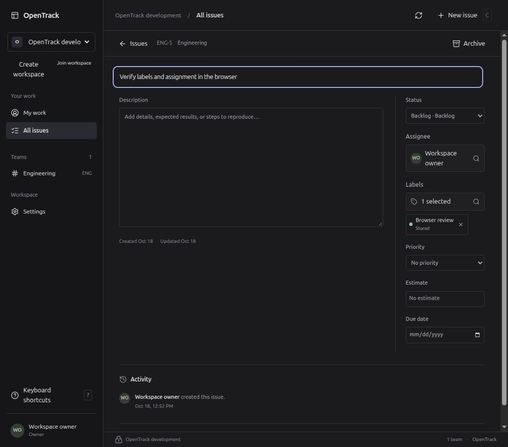

# Labels and eligible assignees

Executed on 18 October 2026, based on workflow checkpoint `d4c066c`. Database, HTTP, build, fixture UI and the browser checks recorded below passed. This does not establish completion of M03 or the complete product.

## Implemented behavior

Shared and team labels support create, search, rename, recolor, archive and restore with optional name repair. Management uses current workspace/team authority; private-team labels remain concealed from administrators without team access. Issue labels form a bounded, deduplicated set with historical archived summaries. Filters support any/all matching and explicit priority ordering with unset last.

The assignee picker uses paginated eligible people, independent self-assignment eligibility and issue-owned historical summaries. An unavailable former assignee remains named on existing work; new assignments require current eligibility. Issue ETags include reference metadata, so a label or eligibility change produces a normal conflict without pretending the issue's own version changed. Archived issues can restore and repair their status, assignee and labels atomically. Assignment notifications and access-loss cleanup are not implemented by this slice.

## Focused executed checks

Environment: Linux x86_64, PostgreSQL 18.6 on isolated loopback 55432, Rust 1.98.1 and Node 22.22.1. Rust integration tests use fresh schemas in the separate test database and restricted runtime identities. Browser verification, when available, uses the native development application separately.

| Check | Observed result |
| --- | --- |
| `opentrack-app/tests/taxonomy_contract.rs` | Passed: management/private-team/viewer boundaries, set constraints, archived references, more than 100 members, bounded/searchable candidates, signed cursor scope checks, any/all and priority keysets, projection conflicts and atomic restore repair. Required audit/event/link/parent-write/idempotency fault injection rolls back. |
| `opentrack-app/tests/taxonomy_races.rs` | Passed: ten observed database lock orders covering shared/team label archive versus application, and membership/private-team-grant/global account disable versus assignment. Ordering is observed through PostgreSQL waiters rather than inferred from sleeps. |
| `opentrack-app/tests/taxonomy_upgrade_contract.rs` | Passed: actual schema 0010 → 0011, old create request hash and stored outcome compatibility, runtime privileges inherited from deployment defaults, continued worker restriction and FORCE RLS. |
| `opentrack-api/tests/taxonomy_contract.rs` and API unit tests | Passed: real database HTTP create/replay/Location, CSRF, missing/stale preconditions, null/unknown field rejection, CSV filters, historical summaries, body/header ETag agreement and activity before/after metadata. Final schema annotations passed the shared check. |
| Frontend tests and isolated build | 109 tests across 11 files passed; TypeScript/Vite build passed into ignored `work/web-taxonomy-dist`, then the production output during shared/native qualification. Includes keyboard picker handling, stale access-context cancellation, expired cursor recovery, draft conflicts, safe creation retry and restore repair. These are fixture UI checks, not native browser proof. |
| Shared `scripts/check.sh` | Exit 0: 62 Rust tests, 109 frontend tests and 11 Python launcher/configuration tests; formatting, workspace/all-target Clippy, generated OpenAPI/TypeScript drift check and production frontend build all passed. Log: `work/check-taxonomy-final.log`. |

Private local run logs are under ignored `work/`: `test-taxonomy-app-final.log`, `test-taxonomy-races-upgrade.log`, `test-taxonomy-api.log`, `clippy-taxonomy-app.log`, `test-taxonomy-ux.log` and `build-taxonomy-ux.log`. Log availability is local; committed tests and this record are the portable evidence.

## Review and repairs

Review found that a suppressed parent issue UPDATE could leave changed links under the old issue version. Issue insert/update and stored creation-outcome writes now require the expected affected rows, with rollback tests. Label creation also verifies its stored idempotency outcome. A race fixture initially blocked a preliminary read rather than the intended mutation lock; its gate was corrected and both actual orders passed. No production race defect was inferred from that fixture timeout.

Label-directory rows and their database sort keys must come from the same SQL snapshot; a two-step ID lookup followed by individual row reads can otherwise return renamed/archived data outside the selected query. Final qualification includes the single-statement projection repair. Activity's generated schema now describes previous/current assignee and label IDs, manual source and the existing workflow replacement status/job metadata.

## Migration and recovery

Migration 0011 adds scoped labels/links and their constraints. Migrations 0001–0010 remain unchanged. New API/frontend require 0011; the status replacement worker needs no label/user privilege. Rollback uses the matching database, server and frontend, not an old executable against newly introduced label data.

The actual running pre-upgrade server binary was preserved from `/proc` into private ignored storage. The frontend from `d4c066c` was independently rebuilt with offline locked dependencies. Their hashes are recorded in `work/postgres/before-0011-builds.json`.

After stopping the verified owned API/worker supervisor, a private 170,537-byte PostgreSQL custom-format backup was restored to the isolated `opentrack_restore_0010_20261018` database. All 28 table/sequence fingerprint entries matched, along with table ownership/RLS/ACL and function ownership/ACL/search paths. Source fingerprints stayed unchanged; restored migrations were exactly 0001–0010. The old binary then served its matching assets on loopback 18971 against only that restored database. Readiness, exact index/two assets, login, bootstrap, a persisted issue read with the same identity/version, logout and subsequent 401 all passed. The child held only runtime/setup credentials and stopped cleanly. No migration or source database write occurred during that rehearsal.

Recovery receipts are `work/postgres/restore-before-0011-result.json` and `work/restore-before-0011-http-result.json`; reusable local harnesses are `work/rehearse-before-0011.py` and `work/restore-before-0011-http.py`. The initial document probe needed `Accept: text/html`; correcting that probe produced the successful asset check. This proves this checkpoint's data/authority and HTTP recovery, not future attachment/key/export or complete-product recovery.

## Local server and browser qualification

The canonical `scripts/dev.sh` launcher applied migration 0011 and started the API and separately credentialed worker on loopback 18970. Readiness returned 200. Native socket verification created shared/team labels and an assigned issue, replayed creation without duplication, reread persisted references, renamed a label, observed a changed representation ETag with unchanged issue version, rejected the stale write with complete current data, retained archived label history, exercised CSV/all filtering and restored an archived issue while unassigning/removing a label atomically. The four expected issue activity entries remained. Verification objects were archived and the temporary session logged out. Receipt: `work/native-taxonomy-result.json`; log: `work/native-taxonomy-verification.log`.

The user cleared the old browser confirmation. In the running browser application, shared label “Browser review” was created with a teal color. The keyboard assignee picker selected the owner; the keyboard label picker applied that label and Escape returned focus to its trigger. Creating ENG-5 (UUID `5d9b1241-4692-46ec-9ade-72c5681aee27`) persisted both properties. A full browser reload displayed the same assignee, label and issue identity. Archiving the label in Settings preserved its existing issue link and displayed “Shared · Archived” after returning to the issue. The verification issue remains available for further development checks. The label was then restored from the archived-label directory; a full issue navigation showed the same attachment as active without reapplying it. Screenshot: `2026-10-18-label-restored.png`.

An execution-environment restart removed the first unsaved issue form and local server process. The existing compiled server and frontend were restarted without a schema upgrade, and the check was repeated against the saved database. The restored browser error page was blocked by the browser URL policy; the user opened a fresh HTTP app tab and testing resumed there. No browser restriction was bypassed. The initial label-name fill also lost its dialog before color selection; reopening and entering the same name succeeded. There was no duplicate label.

Browser evidence covers create, keyboard selection, persistence and archived label display. Browser restore repair and conflict interaction remain separate pending checks; the database/HTTP coverage above does not substitute for them. “Local server” here means the compiled Rust service and browser UI, not an installed desktop client. The separately packaged Tauri desktop client is still being implemented.

