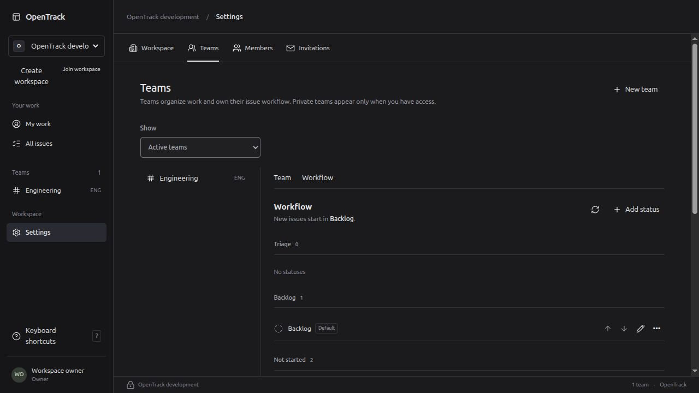

# Team workflows and first durable worker

This increment implements team workflow settings and durable status replacement. It does not complete M03 or the whole product. Labels, eligible assignees, hierarchy/relations, event consumers/checkpoints and retention remain unfinished.

## Implemented behavior

Settings → Teams → Workflow supports named/colored statuses in fixed categories, keyboard reorder controls, an explicit default, archive/restore, historical statuses, and replacement preview/progress/resume. New issues use the server default unless the user explicitly chooses another status. Retiring values remain visible on existing issues but cannot be selected for new assignments. Stable IDs preserve history. Workflow metadata refresh does not overwrite an issue draft.

Replacement is durable PostgreSQL intent. Each transaction moves at most 100 issue references, including archived and soft-deleted issues; progress and required history/events commit together. The source is archived only after references are exhausted. Current account and team authority are rechecked per batch. Browser logout does not cancel intent; lost access blocks effects. Failed or abandoned attempts retry within a five-attempt budget; blocked/dead-letter jobs require an authorized manager’s explicit resume. No external service is required.

The API, migrator, recovery operator and worker have separate database identities. Worker startup checks actual privileges; the worker cannot read passwords, sessions or issue text. API startup refuses worker capabilities. Compose wiring and native launchers carry separate credential environments.

## Focused execution

Environment: Linux x86_64, PostgreSQL 18.6 on isolated loopback 55432, Rust 1.98.1, Node 22.22.1. Rust integration suites create fresh schemas in the separate test database and apply real migrations. Browser checks use the actual native API/database, separately from those contract tests.

- App workflow contract: passed 1/1 in 2.44 seconds. It covers DB-enforced exactly-one default, identity-preserving edits, ordering, archive/history/restore, scope checks, 205 references across three bounded batches, archived/deleted references, and both observed create-versus-retire lock orders. The signed 24-hour cursor authenticity/expiry/binding unit also passed.
- HTTP workflow contract: passed 1/1 in 7.08 seconds with CSRF/origin rejection and unchanged state; defaults/order, 428/422/412 handling, safe create/replacement replay, historical lookup, used-status archive refusal, replacement preview/location/progress pointer, unchanged retiring-status edits, conditional reads after role demotion, and concealed private-team access.
- Worker contract: passed 1/1 in 5.26 seconds before final review fixes. It uses the exact deployment worker grant script and tests clean multi-batch yield, abandoned/stale lease fencing, lease expiry during an observed blocked effect, suppressed mandatory effects, claim/attempt failures, retry/dead letter/resume, access loss and browser logout. Final verification below supersedes this intermediate result.
- Frontend: 88 tests and production build passed. Coverage includes reorder conflict recovery, stale previews, uncertain mutation retry identity, scope changes, the real default, retired/history fallback and preservation of issue drafts.
- Deployment secrets: four tests passed for fresh provisioning, additive upgrades, unchanged credentials, partial/mismatched pairs, unsafe modes and symlinks. Compose 5.6.0 rendered and credential/network/port/read-only dependencies were inspected. Container execution is not available on this host. The real binary also passed `check-config --for worker` with only the worker secret and no public URL/setup credential. Shell syntax checks passed.

## Review and repairs

The read-only integration review found missing transaction timeouts in worker failure bookkeeping, which could wait indefinitely behind another job lock. The fix applies the same 3-second statement, 1-second lock and 5-second idle limits as claim/effect work. A deterministic regression observes failure bookkeeping waiting on a separately held job lock and verifies bounded failure with complete effect rollback. The final worker contract passed 1/1 in 6.29 seconds and the workflow contract passed 1/1 in 2.40 seconds. Review also found blanket test-fixture grants overriding migration 0009’s job restrictions. App/API fixtures now reapply deployed serving-role job permissions; worker tests already used the exact grant helper. The HTTP suite then passed 1/1 in 7.04 seconds with the narrower serving-role grants.

An initial shared check stopped before tests because its shell script was edited while Bash was reading it. It is not a passing result. The script was frozen before a clean rerun.

## Migration and rollback

Migrations 0009–0010 add jobs/attempts, restricted discovery/guard functions, workflow metadata/default constraints and replacement progress. No prior migration was edited. Before applying them to development, a mode-0600 custom-format backup of migrations 1–8 and a mode-0700 copy of the actual running binary were saved in ignored local storage. The dump catalog was readable; the archive has 126090 bytes. Matching frontend assets were rebuilt from commit `cc9d03d` in an isolated ignored rollback directory using the locked, cached dependencies; that build passed. That backup has not been restored in this increment. The prior 0007 restore rehearsal remains separate evidence in [atomic audit qualification](2026-10-17-atomic-audit.md).

There is no automatic down-migration. Rollback needs the matching database backup and binary. No whole-product blob/key restore, other-host recovery, Docker startup, hosted CI or performance qualification is claimed.

A native occupied-port launch was also rejected as intended while the existing application PID remained alive. The supervisor fixture passed signal cleanup and independent child credential checks.

## Final shared and browser verification

`scripts/check.sh` passed on the frozen implementation: **54 Rust tests, 88 frontend tests, 11 Python credential/launcher tests**, formatting, workspace Clippy with warnings denied, generated contract drift, TypeScript and production frontend build. The later archive-dialog refinement passed the complete frontend suite (**90 tests**) and production build. The later launcher restart fix passed its supervisor regression and shell syntax checks; no Rust production code changed after the shared check.

The real native one-command launcher applied migrations 0009–0010 and worker grants and started separate API/worker children on the existing development database. Readiness passed. Process environment inspection checked names only and confirmed API runtime/setup credentials in the API and only the worker credential in the worker. An occupied listener was preserved. The first immediate restart exposed a false occupied-port result from a TIME_WAIT connection; the probe now uses the same address-reuse behavior as the real listener, and native startup succeeded. It still rejects an active listener.

A direct HTTP check against that running native API and separate foreground worker passed: create a status, set it as default, create an issue without an explicit status, preview one affected issue, submit replacement, observe `queued` then `succeeded` with 1 moved/0 remaining, read the updated issue and archived source/job pointer, restore the old status without restoring its job, archive the unused status, and restore the original default. The verification issue was archived and the temporary HTTP session logged out. This is actual socket/API/worker execution, separately from browser evidence.

In the existing authenticated browser, creating “Ready for pickup,” recoloring it blue, moving it above Todo with explicit Save order, and renaming it “Ready” all persisted. A fresh tab confirmed the same stable status ID/order/name. The native archive confirmation then stalled browser input; the available dialog/close controls timed out. No archive success is claimed from that interaction. Archive now uses the existing accessible in-app Modal with Cancel/Escape, request-time close lock, focus restoration and explicit review after a version conflict; its regression tests pass. Remaining live browser archive/restore/default/create/replacement and light-theme interaction checks await clearing the old stuck tab. An asynchronous request identifies the exact browser action needed; independent implementation continues.

Read-only mobile layout at 390×844 showed equal document/client width (390), no body overflow, stacked team/workflow sections and the intentional scrollable settings navigation. The viewport override was reset. This is layout evidence, not a mobile interaction completion claim.

[Mobile layout](2026-10-18-workflows-mobile.png)

## Subsequent browser follow-up

On 18 October the user cleared the earlier native confirmation. The updated in-app archive dialog for the verification status Ready opened with Cancel focused. Escape dismissed it and returned focus to the invoking archive action. Reopening and confirming archived Ready successfully, removed it from the active category and displayed a success message. Expanding Archived statuses and selecting Restore returned the same status to Not started. This closes the earlier archive/restore browser gap; default changes, issue creation against a changed default, replacement progress and light-theme checks remain distinct pending browser cases. The local Rust service plus browser is not the separately planned installable desktop client.
