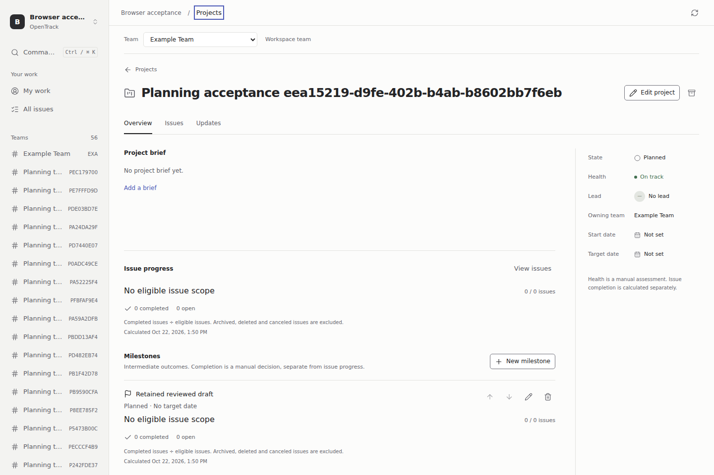
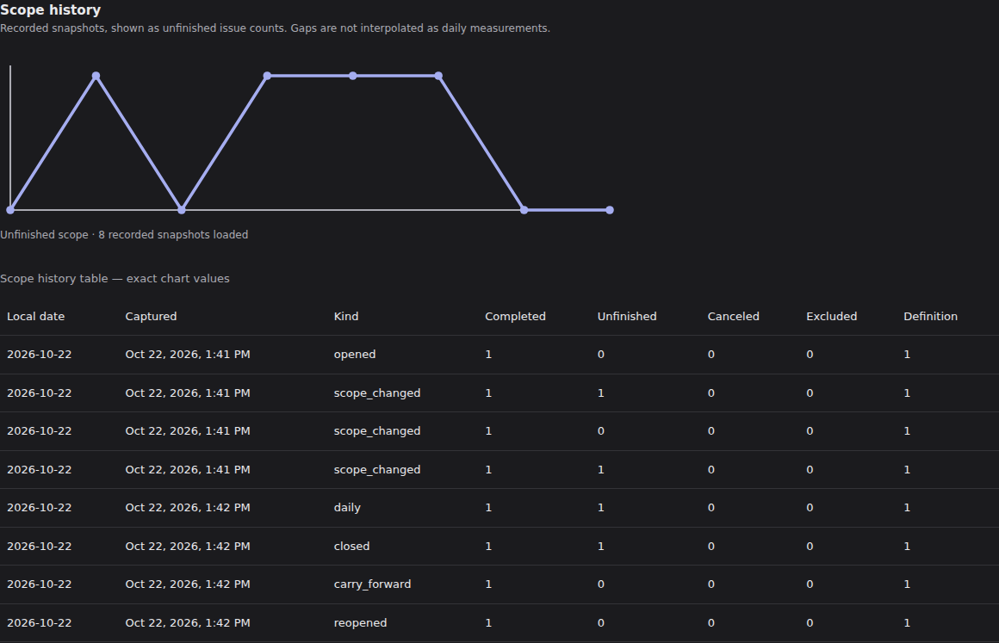

# Planning screen qualification

Executed 22 October 2026 for M05-T04 / issue 29. This increment connects project milestones and team cycles to the existing Projects screens. The [planning guide](../PLANNING.md) documents the workflows and exclusions.

The local application used PostgreSQL 18, the frozen cycle API at `37be5d8` and schema 0024. Frontend checks used Node 24.14.1 and npm 11.11.0; actual browser workflows used Node 22.22.1 under Linux/WSL and the pinned Playwright 1.64.1 Chromium, Firefox and WebKit engines. Only the disposable loopback acceptance runtime and synthetic accounts were used. Credentials remained in private runtime configuration; no authentication state, raw HTTP bodies, traces or videos are published.

## Executed checks

| Check | Observed result |
| --- | --- |
| `npm --prefix web test` | 542 tests across 65 files passed, including 21 focused planning cases and the merged identity/keyboard fixes. |
| `npm --prefix web run typecheck` | Application and browser test types passed against the final generated milestone/cycle contracts. |
| `npm --prefix web run build` | Production assets built successfully. The existing large-chunk advisory remains; no performance benchmark is claimed. |
| Five connected planning browser scenarios across three engines | Initial planning qualification passed 15/15. |
| Extended Chromium carry-forward case, repeated twice | Both repetitions passed after the fixture explicitly reloaded the owner's receipt following its viewer-account access-epoch change. |
| Final combined planning, Projects, palette and keyboard browser run | 39/39 passed: 13 scenarios in each of Chromium, Firefox and WebKit, including all extended carry races and existing Projects workflows. |

The final browser command, from `web/`, is `node node_modules/@playwright/test/cli.js test planning.browser.ts projects.browser.ts palette.browser.ts keyboard.browser.ts`, using the guarded private runtime environment. The sanitized [browser receipt](2026-10-22-planning-browser.json) records each engine, case, outcome and elapsed time.

## Observed workflows

- Project overview, issue scope and authored updates retain their saved workflows. The existing Projects cases verify live completed/open/canceled exclusions, archived/deleted omission, update snapshots and stale brief recovery.
- Milestones persist title, target date and independent manual state. Keyboard move-up/down changes the saved order and restores focus on the moved outcome. Same-project assignment and grouping use server data. Deleting a milestone detaches assignments while preserving the issue and project membership. An empty manually completed milestone shows **No eligible issue scope** with no percentage or progress bar.
- Milestone edits retain a conflicting draft until the saved version is loaded and reviewed. A delayed then failed list request shows loading and a recoverable connection error before a successful retry; the test simulates that request failure rather than claiming physical offline recovery.
- Cycle creation saves local calendar dates, exclusive end, recorded timezone and UTC boundaries across a daylight-saving transition. Overlap rejection and stale metadata edits preserve the typed input.
- The cycle scope picker adds, removes and re-adds an issue without changing its status. Live counts, current issue rows and immutable history come from their scoped endpoints. The chart has an exact HTML table with dates, capture times, metric definitions and counts. At a 390-pixel viewport its scroll area is reachable and scrollable by keyboard without overflowing the page.
- Closure requires a reviewed preview and explicit acknowledgement. Issue facts remain unchanged. Carry-forward starts with no selection and reports each chosen item's result. The original closure report survives explicit movement and reopening with a reason.
- A committed carry response is held while the user attempts issue navigation; the owned busy guard prevents losing the in-flight receipt, then releases before saving its durable operation URL. Reloading that URL restores results. Actual destination and operation-version races clear the stale resume review, reload current versions and require a new selection. Confirmed 409/412 and uncertain retry paths also have focused unit coverage.
- A real viewer opens the same unresolved-operation permalink, reads its results and receives no mutation controls or POST requests. Current-capability changes are also checked at the handler boundary in unit tests. Inaccessible live projections clear the previously rendered cycle facts.

Independent review identified three carry-forward recovery/affordance gaps before publication. Commit `e2583a7` adds the busy guard, conflict-review invalidation and read-only receipt behavior; a second read-only review found no remaining blocker in those changes. One extended Chromium run exposed the fixture's intentional permission-epoch invalidation during viewer creation; reloading the owner's durable receipt before beginning its next review removes that fixture race without changing application authorization behavior. The initial local browser invocation was stopped at the disposable-fixture guard because it used a CRLF environment copy; qualification uses the correct private Linux runtime environment.

Visual review covered actual light/dark project and cycle screens plus 390-pixel mobile reflow. It caught an inherited 16-pixel global SVG height, which made the chart too small even though its exact table worked. A scoped automatic height and aspect ratio correct that rendering; the browser case now requires a desktop chart height greater than 100 pixels. Both themes and the full chart/table were inspected after rebuilding. Root visual/privacy review accepted all eight screenshots and confirmed that their PNGs contain no text or EXIF metadata.

The final combined run also waits for the actual **Search commands** control to become enabled after private-team access refresh, before reopening the palette. This test-only precondition fixes an intermittent refresh race while retaining the direct 404, removed-title and empty-search assertions.

## Scope and limits

This frontend increment adds no migration or server authorization rule. It depends on the separately qualified milestone and cycle backend contracts and preserves their generated types. Reverting these UI changes does not remove durable milestones, cycle snapshots or carry receipts; server/schema compatibility remains governed by their backend guides.

Automatic recurrence, an automatic daily snapshot scheduler, board movement, timelines and broader reporting remain separately tracked. Sparse observations are displayed as observations, without fabricated missing-day measurements. These checks do not qualify a native desktop GUI, assistive technology, physical keyboard layout or real OS IME.
